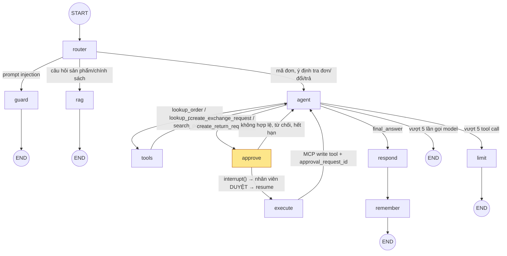

# Fashion Tomodev Agent — LangGraph workflow (Week 7)

Mã nguồn: [`src/features/agent/graph.ts`](../src/features/agent/graph.ts). Graph được compile với `PostgresSaver` (checkpoint, schema `langgraph`) và `PostgresStore` (memory dài hạn).

## Sơ đồ

`interrupt()` nằm trong node **approve**, sau khi server-side validation pass và approval request đã được ghi (idempotent). Graph dừng tại đây cho đến khi `POST /api/admin/approvals/:id/approve|reject` (hoặc worker đánh dấu hết hạn) gọi `Command({ resume })` trên đúng `thread_id`. Khi resume, node chạy lại từ đầu; mọi bước trước `interrupt()` đều là đọc dữ liệu hoặc ghi idempotent.

## Node

| Node | Việc làm |
| --- | --- |
| `guard` | Từ chối prompt injection cơ bản (bỏ qua hướng dẫn, xin system prompt/API key…) mà không gọi model. |
| `router` | Quy tắc, không gọi LLM: injection → `guard`; mã đơn `FT-xxxx-xxxx`, ý định tra đơn/đổi/trả, hoặc câu nối tiếp khi thread đã có đơn → `agent`; còn lại → `rag`. |
| `rag` | Pipeline Week 6: retrieval, `streamText` structured output, validate citation. |
| `agent` | `ChatOpenAI` (Responses API, `gpt-4.1-2025-04-14`, `tool_choice: required`, `parallel_tool_calls: false`) với 6 tool schema. Đọc profile từ Store. |
| `tools` | Gọi read tool qua MCP, ghi source IDs của lượt (`order:*`, `product:*`, `policy:*`). |
| `approve` | Kiểm tra luật đổi/trả, idempotency, tạo approval `pending`, rồi `interrupt()`. |
| `execute` | Sau khi duyệt: gọi MCP write tool kèm `approval_request_id`. |
| `respond` | Validate `final_answer`: citation phải thuộc source IDs mà tool đã trả về trong lượt; mọi con số (giá, ngày, size số…) phải có trong kết quả tool, lời khách hoặc ngày hiện tại. |
| `remember` | Lưu size thường chọn và yêu cầu gần nhất vào Store (namespace `['fashion-tomodev', hmac(visitorId), 'profile']`, TTL 30 ngày). |
| `limit` | Dừng an toàn khi vượt giới hạn tool call. |

## State

| Trường | Ý nghĩa |
| --- | --- |
| `messages` | Lịch sử hội thoại (human, AI tool calls, tool results, câu trả lời). |
| `userId` | HMAC của visitor id (khách ẩn danh). |
| `orderId` | Mã đơn đã xác định trong thread. |
| `pendingAction` | Yêu cầu đã được duyệt, chờ `execute` (approval id, tool call id, payload, ghi chú). |
| `approvalStatus` | `none` / `approved` / `rejected` / `expired` (trạng thái `pending` nằm trong bảng `approval_requests` khi graph đang dừng). |
| `route`, `turnSources`, `lastSources`, `modelCalls`, `toolCalls`, `finalAnswer`, `lastRequest` | Định tuyến, nguồn hợp lệ của lượt, nguồn cho câu nối tiếp, bộ đếm giới hạn, kết quả và dữ liệu cho memory. |

## Tool và quyền

| Tool (MCP) | Loại | Quyền / ràng buộc |
| --- | --- | --- |
| `lookup_order(order_id)` | Read-only | Đơn giả lập trong Postgres, không có PII. |
| `lookup_product(product_id)` | Read-only | Đọc chunk sản phẩm của version catalog đang active. |
| `search_policy(query)` | Read-only | RAG chỉ trên chunk `policy`. |
| `create_exchange_request(order_id, product_id, requested_size, approval_request_id)` | Write | Model không thấy `approval_request_id`; server điền sau khi duyệt. MCP từ chối nếu approval không `approved` hoặc payload không khớp. Idempotent theo `order_id + product_id + action + size`. |
| `create_return_request(order_id, product_id, reason, approval_request_id)` | Write | Như trên; `reason ∈ {wrong_item, wrong_size_or_color, manufacturing_defect}`. |

MCP server chạy Streamable HTTP tại `http://mcp:3001/mcp`, không publish port ra host hoặc Cloudflare Tunnel.

## Giới hạn

- Tối đa 5 lần gọi model và 5 tool call cho mỗi tin nhắn mới hoặc mỗi lần resume (`AGENT_MAX_STEPS`, `AGENT_MAX_TOOL_CALLS`).
- Approval hết hạn sau 7 ngày; worker chuyển `expired` và resume để Agent báo khách.
- Checkpoint của thread không hoạt động 30 ngày bị xóa; memory có TTL 30 ngày.
