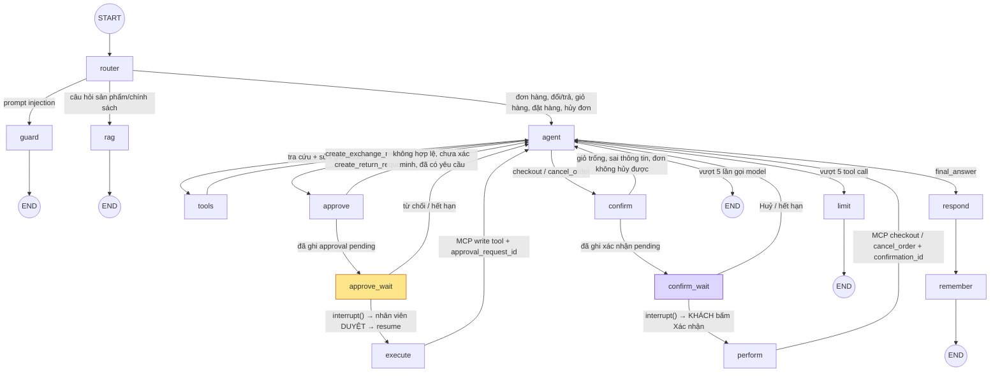

# Fashion Tomodev Agent — LangGraph workflow (Week 7)

Mã nguồn: [`src/features/agent/graph.ts`](../src/features/agent/graph.ts). Graph được compile với `PostgresSaver` (checkpoint, schema `langgraph`) và `PostgresStore` (memory dài hạn).

## Sơ đồ

`interrupt()` nằm trong node **approve_wait** (và **confirm_wait** cho khách). Mỗi cặp tách làm hai: node *chuẩn bị* (`approve` / `confirm`) kiểm tra luật và ghi bản ghi `pending`; node *chờ* chỉ gọi `interrupt()` và không ghi gì, vì khi resume LangGraph chạy lại node từ đầu (nếu ghi DB trước `interrupt()` thì lần resume sau khi từ chối/hủy sẽ sinh một bản ghi `pending` thừa). Với duyệt của nhân viên, graph dừng tại đây cho đến khi `POST /api/admin/approvals/:id/approve|reject` (hoặc worker đánh dấu hết hạn) gọi `Command({ resume })` trên đúng `thread_id`. Khi resume, node chạy lại từ đầu; mọi bước trước `interrupt()` đều là đọc dữ liệu hoặc ghi idempotent.

## Node

| Node | Việc làm |
| --- | --- |
| `guard` | Từ chối prompt injection cơ bản (bỏ qua hướng dẫn, xin system prompt/API key…) mà không gọi model. |
| `router` | Quy tắc, không gọi LLM: injection → `guard`; mã đơn `FT-xxxx-xxxx`, ý định tra đơn/đổi/trả, hoặc câu nối tiếp khi thread đã có đơn → `agent`; còn lại → `rag`. |
| `rag` | Pipeline Week 6: retrieval, `streamText` structured output, validate citation. |
| `agent` | `ChatOpenAI` (Responses API, `gpt-4.1-2025-04-14`, `tool_choice: required`, `parallel_tool_calls: false`) với 6 tool schema. Đọc profile từ Store. |
| `tools` | Gọi read tool và tool sửa giỏ (hoàn tác được) qua MCP, ghi source IDs của lượt (`order:*`, `product:*`, `policy:*`, `cart:current`). `lookup_order` xác minh chủ đơn. |
| `approve` / `approve_wait` | Kiểm tra đơn đã xác minh, luật đổi/trả, chọn đúng dòng đơn, idempotency, ghi approval `pending`; rồi `interrupt()` chờ nhân viên. |
| `execute` | Sau khi duyệt: gọi MCP write tool kèm `approval_request_id`. |
| `confirm` / `confirm_wait` | `checkout` / `cancel_order`: kiểm tra đầu vào (SĐT phải do khách gõ, giỏ không trống/không lỗi, đơn xác minh và còn hủy được), ghi `customer_confirmations` `pending` kèm chi tiết khách sẽ thấy; rồi `interrupt()` chờ khách bấm nút. |
| `perform` | Sau khi khách xác nhận: gọi MCP `checkout` / `cancel_order` chỉ với `confirmation_id`. |
| `respond` | Validate `final_answer`: citation phải thuộc source IDs mà tool đã trả về trong lượt; mọi con số (giá, ngày, size số…) phải có trong kết quả tool, lời khách hoặc ngày hiện tại. |
| `remember` | Lưu size thường chọn và yêu cầu gần nhất vào Store (namespace `['fashion-tomodev', hmac(visitorId), 'profile']`, TTL 30 ngày). |
| `limit` | Dừng an toàn khi vượt giới hạn tool call. |

## State

| Trường | Ý nghĩa |
| --- | --- |
| `messages` | Lịch sử hội thoại (human, AI tool calls, tool results, câu trả lời). |
| `userId` | HMAC của visitor id (khách ẩn danh). |
| `orderId` | Mã đơn đã xác định trong thread. |
| `awaiting` | Việc đã chuẩn bị đang chờ quyết định (duyệt hoặc xác nhận), để node chờ không có side effect. |
| `verifiedOrders` | Các đơn khách đã chứng minh sở hữu trong thread (đặt từ trình duyệt này hoặc đúng SĐT). Đổi/trả bắt buộc phải có. |
| `shopContext` | Lượt trước đã đi vào agent: câu nối tiếp ngắn ("size L", "COD") ở lại agent. |
| `pendingAction` | Yêu cầu đã được duyệt, chờ `execute` (approval id, tool call id, payload, ghi chú). |
| `approvalStatus` | `none` / `approved` / `rejected` / `expired` (trạng thái `pending` nằm trong bảng `approval_requests` khi graph đang dừng). |
| `route`, `turnSources`, `lastSources`, `modelCalls`, `toolCalls`, `finalAnswer`, `lastRequest` | Định tuyến, nguồn hợp lệ của lượt, nguồn cho câu nối tiếp, bộ đếm giới hạn, kết quả và dữ liệu cho memory. |

## Tool và quyền

| Tool (MCP) | Loại | Quyền / ràng buộc |
| --- | --- | --- |
| `lookup_order(order_id, phone)` → MCP `verify_order` | Read-only | Trả đơn (không PII) chỉ khi đơn đặt từ chính trình duyệt này hoặc `phone` khớp. Sai/không tồn tại cho cùng một thông báo; sai > 5 lần bị khóa theo thread và theo mã đơn. SĐT model gửi phải xuất hiện trong lời khách. |
| `lookup_product(product_id)` | Read-only | Giá, size, màu, tồn kho từ DB. |
| `search_products(query, max_price_vnd)` | Read-only | Tối đa 5 sản phẩm đang bán; bỏ bớt từ cuối khi không khớp. |
| `search_policy(query)` | Read-only | RAG chỉ trên chunk `policy`. |
| `view_cart()` | Read-only | Giỏ của chủ thread; tiền do server tính. |
| `add_to_cart` / `set_cart_quantity` | Write, hoàn tác được | Chạy ngay; khách xác định bởi `thread_id` do graph điền, không do model. Không vượt tồn kho/10 cái mỗi dòng. |
| `checkout()` | Write, **khách xác nhận** | Graph chỉ gửi `confirmation_id`; MCP chạy đúng họ tên/SĐT/địa chỉ/thanh toán đã lưu trong thẻ khách đã thấy, từ chối nếu giỏ/giá đổi (fingerprint), dùng một lần, idempotent theo `confirmation_id`. |
| `cancel_order(order_id, phone)` | Write, **khách xác nhận** | Đơn đang xử lý và chưa thanh toán; xác nhận gắn với trạng thái đơn lúc hỏi. |
| `create_exchange_request(order_id, product_id, requested_size, item_size, item_color, approval_request_id)` | Write, **nhân viên duyệt** | Model không thấy `approval_request_id`; MCP từ chối nếu approval không `approved` hoặc payload không khớp. `item_size/item_color` chọn dòng khi đơn có nhiều dòng cùng sản phẩm (thiếu → `ambiguous_item`). Idempotent theo `order_id + product_id + action + size (+ dòng)`. |
| `create_return_request(order_id, product_id, reason, item_size, item_color, approval_request_id)` | Write, **nhân viên duyệt** | Như trên; `reason ∈ {wrong_item, wrong_size_or_color, manufacturing_defect}`. |

**Xác nhận của khách** (`customer_confirmations`): chỉ `POST /api/chat/confirmations/:id` (cookie visitor sở hữu thread) ghi được quyết định `confirmed`/`cancelled`; model không có đường nào để tự xác nhận. Mỗi thread có tối đa một xác nhận `pending`; hết hạn sau 30 phút (lần nhắn tiếp theo đóng nó và agent báo "chưa thực hiện"). Khi có xác nhận đang chờ, ô nhập khóa và `POST /api/chat` trả thông báo "hãy bấm Xác nhận hoặc Huỷ".

MCP server chạy Streamable HTTP tại `http://mcp:3001/mcp`, không publish port ra host hoặc Cloudflare Tunnel.

## Giới hạn

- Tối đa 5 lần gọi model và 5 tool call cho mỗi tin nhắn mới hoặc mỗi lần resume (`AGENT_MAX_STEPS`, `AGENT_MAX_TOOL_CALLS`).
- Approval hết hạn sau 7 ngày; worker chuyển `expired` và resume để Agent báo khách.
- Checkpoint của thread không hoạt động 30 ngày bị xóa; memory có TTL 30 ngày.
