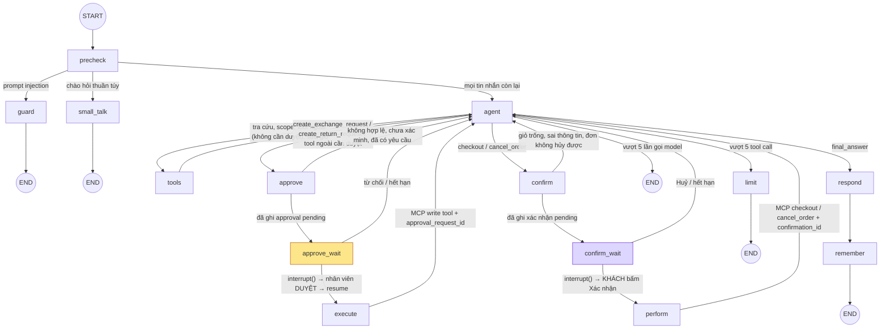

# Fashion Tomodev Agent — LangGraph workflow (Week 7)

Mã nguồn: [`src/features/agent/graph.ts`](../src/features/agent/graph.ts). Graph được compile với `PostgresSaver` (checkpoint, schema `langgraph`) và `PostgresStore` (memory dài hạn).

## Sơ đồ

`interrupt()` nằm trong node **approve_wait** (và **confirm_wait** cho khách). Mỗi cặp tách làm hai: node *chuẩn bị* (`approve` / `confirm`) kiểm tra luật và ghi bản ghi `pending`; node *chờ* chỉ gọi `interrupt()` và không ghi gì, vì khi resume LangGraph chạy lại node từ đầu (nếu ghi DB trước `interrupt()` thì lần resume sau khi từ chối/hủy sẽ sinh một bản ghi `pending` thừa). Với duyệt của nhân viên, graph dừng tại đây cho đến khi `POST /api/admin/approvals/:id/approve|reject` (hoặc worker đánh dấu hết hạn) gọi `Command({ resume })` trên đúng `thread_id`. Khi resume, node chạy lại từ đầu; mọi bước trước `interrupt()` đều là đọc dữ liệu hoặc ghi idempotent.

## Node

| Node | Việc làm |
| --- | --- |
| `guard` | Từ chối prompt injection cơ bản (bỏ qua hướng dẫn, xin system prompt/API key…) mà không gọi model. |
| `precheck` | Quy tắc, không gọi LLM: injection → `guard`; chào hỏi thuần túy → `small_talk`; còn lại → `agent`. Không còn phân loại theo regex: model chọn tool (scope tri thức, `search_products`, đơn hàng…) dựa vào tên và mô tả tool. |
| `small_talk` | Trả lời cố định cho câu chào, không gọi model. |
| `agent` | `ChatOpenAI` (Responses API, `tool_choice: required`, `parallel_tool_calls: false`). Model, temperature, giới hạn bước, hướng dẫn và danh sách tool đọc từ **Agent sở hữu thread** (`ai_agents`, xem mục Agent và cấu hình bên dưới). Đọc profile từ Store. |
| `tools` | Gọi read tool và tool sửa giỏ (hoàn tác được) qua MCP, ghi source IDs của lượt (`order:*`, `product:*`, `policy:*`, `cart:current`). `lookup_order` xác minh chủ đơn. |
| `approve` / `approve_wait` | Đổi/trả: kiểm tra đơn đã xác minh, luật đổi/trả, chọn đúng dòng đơn, idempotency, ghi approval `pending`. Tool ngoài cần duyệt: kiểm tra tham số theo schema của server rồi ghi approval `mcp_tool` (khóa idempotency gồm id lần gọi nên mỗi lần gọi cần một lần duyệt mới). Sau đó `interrupt()` chờ nhân viên. |
| `execute` | Sau khi duyệt: gọi MCP write tool kèm `approval_request_id`; với tool ngoài thì kiểm tra Agent vẫn còn tool đó (admin có thể gỡ trong lúc chờ) rồi gọi. |
| `confirm` / `confirm_wait` | `checkout` / `cancel_order`: kiểm tra đầu vào (SĐT phải do khách gõ, giỏ không trống/không lỗi, đơn xác minh và còn hủy được), ghi `customer_confirmations` `pending` kèm chi tiết khách sẽ thấy; rồi `interrupt()` chờ khách bấm nút. |
| `perform` | Sau khi khách xác nhận: gọi MCP `checkout` / `cancel_order` chỉ với `confirmation_id`. |
| `respond` | Validate `final_answer`: citation phải thuộc source IDs mà tool đã trả về trong lượt; mọi con số (giá, ngày, size số…) phải có trong kết quả tool, lời khách hoặc ngày hiện tại. |
| `remember` | Lưu size thường chọn và yêu cầu gần nhất vào Store (namespace `['fashion-tomodev', hmac(visitorId), 'profile']`, TTL 30 ngày). |
| `limit` | Dừng an toàn khi vượt giới hạn tool call. |

## State

| Trường | Ý nghĩa |
| --- | --- |
| `messages` | Lịch sử hội thoại (human, AI tool calls, tool results, câu trả lời). |
| `userId` | HMAC của visitor id (khách ẩn danh). |
| `orderId` | Mã đơn đã xác định trong thread. |
| `awaiting` | Việc đã chuẩn bị đang chờ quyết định (duyệt hoặc xác nhận), để node chờ không có side effect. |
| `verifiedOrders` | Các đơn khách đã chứng minh sở hữu trong thread (đặt từ trình duyệt này hoặc đúng SĐT). Đổi/trả bắt buộc phải có. |
| `shopContext` | Lượt trước đã đi vào agent: câu nối tiếp ngắn ("size L", "COD") ở lại agent. |
| `pendingAction` | Yêu cầu đã được duyệt, chờ `execute` (approval id, tool call id, payload, ghi chú). |
| `approvalStatus` | `none` / `approved` / `rejected` / `expired` (trạng thái `pending` nằm trong bảng `approval_requests` khi graph đang dừng). |
| `route`, `turnSources`, `lastSources`, `modelCalls`, `toolCalls`, `finalAnswer`, `lastRequest` | Định tuyến, nguồn hợp lệ của lượt, nguồn cho câu nối tiếp, bộ đếm giới hạn, kết quả và dữ liệu cho memory. |

## Tool và quyền

| Tool (MCP) | Loại | Quyền / ràng buộc |
| --- | --- | --- |
| `lookup_order(order_id, phone)` → MCP `verify_order` | Read-only | Trả đơn (không PII) chỉ khi đơn đặt từ chính trình duyệt này hoặc `phone` khớp. Sai/không tồn tại cho cùng một thông báo; sai > 5 lần bị khóa theo thread và theo mã đơn. SĐT model gửi phải xuất hiện trong lời khách. |
| `lookup_product(product_id)` | Read-only | Giá, size, màu, tồn kho từ DB. |
| `search_products(query, max_price_vnd)` | Read-only | Tối đa 5 sản phẩm đang bán; bỏ bớt từ cuối khi không khớp. |
| `<tool_name của Knowledge scope>(query)` | Read-only | Mỗi scope được bật cho Agent là một tool; tên và mô tả do admin đặt. Chỉ tìm trong các file của scope (và chunk phí giao hàng hệ thống sinh nếu scope bật). MCP kiểm tra scope thuộc Agent của thread. Scope seed mặc định tên `search_policy`. |
| `view_cart()` | Read-only | Giỏ của chủ thread; tiền do server tính. |
| `add_to_cart` / `set_cart_quantity` | Write, hoàn tác được | Chạy ngay; khách xác định bởi `thread_id` do graph điền, không do model. Không vượt tồn kho/10 cái mỗi dòng. |
| `checkout()` | Write, **khách xác nhận** | Graph chỉ gửi `confirmation_id`; MCP chạy đúng họ tên/SĐT/địa chỉ/thanh toán đã lưu trong thẻ khách đã thấy, từ chối nếu giỏ/giá đổi (fingerprint), dùng một lần, idempotent theo `confirmation_id`. |
| `cancel_order(order_id, phone)` | Write, **khách xác nhận** | Đơn đang xử lý và chưa thanh toán; xác nhận gắn với trạng thái đơn lúc hỏi. |
| `create_exchange_request(order_id, product_id, requested_size, item_size, item_color, approval_request_id)` | Write, **nhân viên duyệt** | Model không thấy `approval_request_id`; MCP từ chối nếu approval không `approved` hoặc payload không khớp. `item_size/item_color` chọn dòng khi đơn có nhiều dòng cùng sản phẩm (thiếu → `ambiguous_item`). Idempotent theo `order_id + product_id + action + size (+ dòng)`. |
| `create_return_request(order_id, product_id, reason, item_size, item_color, approval_request_id)` | Write, **nhân viên duyệt** | Như trên; `reason ∈ {wrong_item, wrong_size_or_color, manufacturing_defect}`. |

**Xác nhận của khách** (`customer_confirmations`): chỉ `POST /api/chat/confirmations/:id` (cookie visitor sở hữu thread) ghi được quyết định `confirmed`/`cancelled`; model không có đường nào để tự xác nhận. Mỗi thread có tối đa một xác nhận `pending`; hết hạn sau 30 phút (lần nhắn tiếp theo đóng nó và agent báo "chưa thực hiện"). Khi có xác nhận đang chờ, ô nhập khóa và `POST /api/chat` trả thông báo "hãy bấm Xác nhận hoặc Huỷ".

MCP server chạy Streamable HTTP tại `http://mcp:3001/mcp`, không publish port ra host hoặc Cloudflare Tunnel.

## Agent và cấu hình (Phase 1–3 refactor)

- `ai_agents`: hướng dẫn (`instructions`, admin sửa được), model, temperature, `max_steps`, `max_tool_calls`, `is_default`. **System prompt nằm hoàn toàn trong `instructions` của Agent**: admin tự viết, hoặc bấm “Tạo prompt bằng AI” ở form Agent (`POST /api/admin/agents/generate-prompt`; model sinh = model đã chọn trong form; “người viết prompt” là `prompts/agent-prompt-writer.md`, nhận mô tả của admin + tool/scope/MCP đang chọn, kết quả chỉ lưu khi admin bấm Lưu). Mỗi lượt code chỉ thêm một khối dữ kiện sau prompt (ngày, source_id hợp lệ, thông tin khách đã lưu: `turnContextBlock`), không thêm quy tắc nào. `prompt_tools_signature` ghi tool/scope lúc AI viết để form cảnh báo khi tool đổi. Prompt mặc định để seed: `prompts/fashion-tomodev-agent-default.md`. Các chốt chặn (xác minh chủ đơn, nút Xác nhận, nhân viên duyệt, grounding số liệu, giới hạn bước) do code thực hiện, không phụ thuộc prompt. `chat_threads.agent_id` gắn thread với Agent lúc tạo; thread không có Agent (hoặc Agent đã lưu trữ) dùng Agent mặc định.
- Cấu hình được đọc lại mỗi node (cache 5 giây trong tiến trình) qua `deps.loadAgent(threadId)`; graph chỉ compile một lần. `tools`, `approve`, `confirm` từ chối tool built-in không được bật cho Agent (`tool_unavailable`) và scope tool không thuộc Agent.
- **Tool theo MCP server**: tool được tick trên chính MCP server (`mcp_servers.selected_tools`, trang Admin → MCP Server); Agent chỉ chọn danh sách MCP server (`agent_mcp_servers`, dropdown chọn nhiều) và dùng **tất cả tool đã tick** của từng server đang bật. Với server built-in, tick chọn tool trong 10 tool của hệ thống; luật HITL của từng tool built-in là hằng số trong code (`src/features/agent/tools.ts`), không cấu hình được. Hệ quả: lựa chọn tool áp dụng cho mọi Agent dùng server đó.
- `knowledge_scopes` + `knowledge_scope_documents` (N–N với file) + `agent_knowledge_scopes`. File catalog sản phẩm (`db:catalog`) không gán được vào scope; sản phẩm tìm bằng tool `search_products` (từ khóa + vector, giá/tồn kho luôn đọc từ DB).
- `mcp_servers`: Admin → MCP Server (Streamable HTTP, xác thực Bearer/header mã hóa AES-256-GCM, chặn SSRF, không theo redirect). Khi thêm/sửa: nhập kết nối → **Lấy danh sách tool** (`POST /api/admin/mcp-servers/discover`, chưa lưu gì) → tick tool (và "cần nhân viên duyệt" cho tool có thể gây thay đổi; tool có `destructiveHint` được đánh dấu sẵn) → Lưu. Khi lưu, hệ thống kết nối lại để xác nhận tool đã tick còn tồn tại và lưu danh sách mới. Server built-in không sửa/tắt/xóa được, chỉ đổi tool được tick.
- **Tool ngoài (Phase 4)**: Agent chỉ thấy tool đã được tick trên các MCP server nó dùng, tên dạng `<server_slug>__<tool>`. Schema gửi cho OpenAI ở chế độ non-strict (tool của hệ thống vẫn strict); tham số được validate theo JSON Schema của server trước khi gọi. Không gửi `thread_id`/danh tính khách. Kết quả được bọc là dữ liệu không tin cậy (`notice`), cắt ở 8000 ký tự, và gắn source `mcp:<server>:<tool>` để trích dẫn. Tool đánh dấu "cần nhân viên duyệt" đi qua `approve` → `approve_wait` → `execute`; trang Phê duyệt hiện tool và tham số.
- **Agent**: Admin → AI Agents tạo/sửa Agent (hướng dẫn, model trong `OPENAI_ALLOWED_MODELS`, temperature, giới hạn, scope, tool). Agent mặc định trả lời khách trên website; không xóa/tắt được. Agent đã có chat chỉ được lưu trữ. "Chat thử" trong trang Agent gọi `/api/chat` với `agentId` (chỉ nhận khi có phiên admin), thread gắn `is_test`.
- Không còn stream từng phần câu trả lời (event `partial` chỉ có ở nhánh `rag` cũ); widget hiện trạng thái theo từng tool (`status`).

## Giới hạn

- Tối đa 5 lần gọi model và 5 tool call cho mỗi tin nhắn mới hoặc mỗi lần resume (`AGENT_MAX_STEPS`, `AGENT_MAX_TOOL_CALLS`).
- Approval hết hạn sau 7 ngày; worker chuyển `expired` và resume để Agent báo khách.
- Checkpoint của thread không hoạt động 30 ngày bị xóa; memory có TTL 30 ngày.
- **Hộp sản phẩm trong widget**: node `respond` giữ lại nguồn `product:<mã>` mà model trích dẫn **và** các sản phẩm của lượt đó được nhắc trong câu trả lời (theo mã như `SM-001` hoặc đúng tên; xem `src/features/agent/mentions.ts`). `/api/chat` (event `complete`) và `/api/chat/threads/:id` đọc lại các sản phẩm này từ DB (`src/features/chat/product-cards.ts`, tối đa 5, giá/tồn kho/ảnh luôn mới, bỏ qua sản phẩm đã ẩn) và trả về trường `products`. Widget (`chat-product-cards.tsx`) hiển thị thành hộp bấm được tới `/p/<slug>`; trên điện thoại khung chat tự thu nhỏ sau khi bấm.
