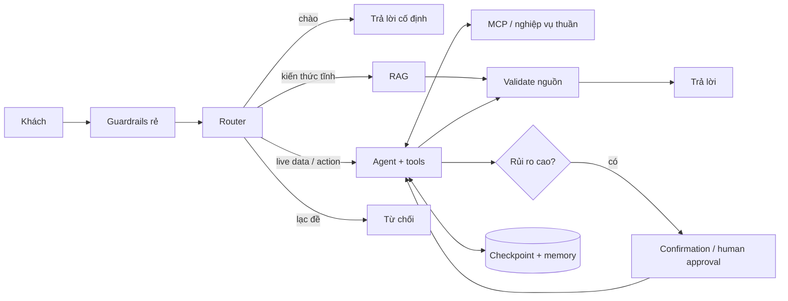

# Week 8 — Case study ShopMobile: từ bài toán đến AI Agent an toàn

> Nguồn: `week_8.pptx` (38 slide). Đây là bản chắt lọc kiến trúc/cách làm của case study ShopMobile, được dùng để đối chiếu với Fashion Tomodev chứ không sao chép mù quáng công nghệ hay chính sách demo.

## Luận điểm của case study

Thiết kế agent bắt đầu từ **bản chất dữ liệu và rủi ro**, không bắt đầu từ framework:

| Loại nhu cầu | Cách đáp ứng phù hợp |
| --- | --- |
| Kiến thức tĩnh: chính sách, bảo hành, hướng dẫn | RAG có citation |
| Dữ liệu sống: giá, tồn kho, đơn, giỏ | Read tool/API/DB |
| Hành động có thể hoàn tác, rủi ro thấp | Tool write bị giới hạn |
| Tiền, hủy, hoàn, thay đổi có hậu quả | Xác nhận/duyệt + điều kiện server-side |
| Ngoài phạm vi, spam, injection | Chặn/từ chối trước hoặc trong workflow |

Từ mỗi rủi ro, tạo một nguyên tắc có thể kiểm chứng: không bịa dữ liệu sống, không để model sở hữu identity, không tự tính tiền, không để write có hậu quả vượt qua phê duyệt, không cho injection đến model nếu rule rẻ đã nhận diện được, không để vòng tool vô hạn.

## Kiến trúc tham chiếu

Phân tách “bộ não” (LLM/router), “đôi tay” (tool/service) và “bộ nhớ” (checkpoint/store) giúp giới hạn quyền, kiểm thử nghiệp vụ độc lập và thay thế từng phần.

## Các quyết định thiết kế then chốt

### 1. Router trước, nhánh rõ ràng

Router phân biệt chat, RAG policy, live shop/action và out-of-scope. Nó viết lại câu nối tiếp thành câu hỏi độc lập. Nếu router/model lỗi hoặc JSON sai, chọn default an toàn (thường RAG với câu gốc) thay vì crash hoặc thực hiện write.

### 2. RAG chỉ dùng cho tri thức tĩnh

RAG không phải nguồn cho giá, tồn kho, giỏ, trạng thái đơn, thanh toán hay kết quả hoàn tiền. Retrieval gồm content hash → chunk theo heading/breadcrumb → embedding → vector search → rerank → score threshold; không đạt ngưỡng thì decline, không gọi model để đoán.

### 3. Tool là API hợp đồng chặt

Viết service nghiệp vụ thuần trước rồi mới bọc MCP/tool. Tool dùng schema/type rõ, validate input ở server, trả lỗi nghiệp vụ có cấu trúc và không nhận số tiền do model tính. Tool write phải mô tả điều kiện gọi nhưng điều kiện cuối vẫn do server/graph ép.

### 4. Identity do server kiểm soát

`session_id`, visitor/user/tenant scope và approval ID không được để model điền. Server gắn chúng vào config/call; tool chỉ thao tác trong scope đó. Với khách ẩn danh, xác minh quyền sở hữu đơn qua cơ chế độc lập (ví dụ browser owner hoặc số điện thoại), phản hồi không làm lộ sự tồn tại của đơn và rate-limit việc dò đoán.

### 5. Phân loại write theo rủi ro

- Read-only: chạy bình thường sau auth/scope.
- Write nhẹ/có thể hoàn tác: vẫn validate/limit/idempotent.
- Write nặng: khách xác nhận rõ hoặc nhân viên duyệt; server lưu pending request với payload đã kiểm tra và execute chỉ sau quyết định hợp lệ.

Xác nhận “mềm” trong prompt/UI là trải nghiệm tốt nhưng không phải security boundary. Với checkout, thanh toán, hủy hay xóa, cổng “cứng” bằng `interrupt()`/resume hoặc endpoint xác nhận được ủy quyền là ưu tiên.

## State, hội thoại và graph

State cần tối thiểu có messages, route, câu hỏi đã rewrite, documents của lượt, counter lạc đề/tool/model, identity server-side và trạng thái hành động pending. Reset các field theo lượt (như documents) để không rò context cũ.

Graph có node nhỏ: analyze → retrieve/generate hoặc shop agent → tools → shop agent; thêm decline, summarize, approval/confirmation và response validation. Conditional edge phải thể hiện rõ tất cả route và đường lỗi.

Với hội thoại dài, lưu checkpoint theo `thread_id`, chỉ gửi window hợp lệ và summary của phần cũ. Khi cắt phải không để sót ToolMessage không có AI tool-call đi kèm; dọn các tool call dang dở trước lượt sau.

## Prompt, guardrail và đường lui

Prompt cho nhánh shop là quy trình nghiệp vụ: dữ liệu sống phải đến từ tool trong lượt hiện tại; tiền do server/tool tính; hành động rủi ro chỉ sau xác nhận mới nhất; không lộ tool/ID/nội bộ; không hứa kết quả mà hệ thống chưa thực hiện.

Guardrails dùng các lớp rẻ trước: regex/length/spam/injection → router out-of-scope → leo thang theo số lượt → prompt → server/tool authorization. Các câu bị rule chặn không nên tới LLM.

| Sự cố | Hành vi an toàn |
| --- | --- |
| MCP/tool chưa sẵn sàng | Giữ nhánh knowledge hoạt động; không giả dữ liệu sống; retry có kiểm soát |
| Tool lỗi | Đưa ToolMessage lỗi để agent báo phù hợp; không làm sập thread |
| Router JSON sai | Default route/query an toàn |
| Tool loop | `recursion_limit`/max calls, sau đó yêu cầu khách chia nhỏ |
| RAG rỗng | Nói chưa có thông tin |
| Provider/DB lỗi | Phản hồi lỗi tạm thời có kiểm soát, trace để điều tra |

## Lộ trình hiện thực bảy bước

1. Hai LLM client: model nhanh, deterministic cho router/summary và model trả lời; làm sạch/parse output tập trung.
2. RAG: schema vector, chunk có heading/breadcrumb, ingest theo hash, retrieval/rerank/threshold.
3. MCP: service nghiệp vụ thuần → tool schema/documentation → server riêng có auth/health.
4. Nạp tool vào agent: filter capability và server-injected session/context.
5. LangGraph: state, prompts, nodes, conditional edge, checkpoint và fallback khi tool vắng mặt.
6. Runner/API: thread/config do server đặt, recursion limit, streaming chỉ những node được phép.
7. Guardrail và tests: fake model/searcher/checkpointer cho test graph nhanh; DB thật cho nghiệp vụ/tool.

## Kiểm chứng bằng bất biến

Mỗi quyết định phải có test minh chứng. Đặc biệt giữ hard-fail bằng 0: không nói hoàn tiền khi chưa hoàn, không write khi chưa xác nhận/duyệt, không truy cập đơn người khác, không bịa giá/tồn kho/thời gian giao, không lộ prompt, không bypass cổng nhân viên và không ghi PII nhạy cảm vào log.

Test theo nhánh (chat/RAG/shop/out-of-scope), router parse lỗi, RAG rỗng, tool missing/error/loop, identity injection, idempotency, checkpoint/resume và response validation. Dùng fake LLM/tool để test deterministically, bổ sung integration test với DB cho luật nghiệp vụ.

## Đối chiếu với Fashion Tomodev

Project đã có những cấu phần tương ứng: retrieval/citation validation, MCP nội bộ, LangGraph checkpoint/store, server-side visitor scope, xác nhận khách cho checkout/hủy đơn, approval nhân viên cho đổi/trả, guardrail/trace và eval. Chi tiết triển khai thực tế nằm trong [`../agent-graph.md`](../agent-graph.md), các test ở `tests/` và README; chúng là chuẩn khi tài liệu bài giảng và repo khác nhau.

