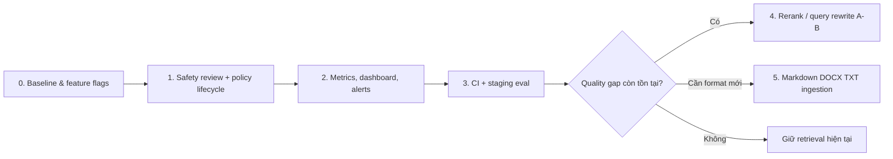

# Kế hoạch hoàn thiện Week 6 — RAG safety, quality và vận hành

> Nguồn yêu cầu: [audit Week 6](../report/week-6-rag-audit.md). Các hạng mục P2 chỉ bật sau khi baseline eval chứng minh có lợi ích.
>
> **Trạng thái 05-11-2026:** đã hiện thực safety review/quarantine, lifecycle metadata + policy resolver, Markdown/TXT ingestion, Monitoring Admin và CI DB-test workflow. Chưa chạy được baseline eval live trong workspace hiện tại; reranker/query rewrite vẫn tắt đúng theo cổng P2. Alert external (Grafana/Prometheus/OTel collector) cần hạ tầng triển khai để cấu hình tiếp.

## 1. Mục tiêu và phạm vi

Hoàn thiện toàn bộ các mục “chưa áp dụng hoặc mới áp dụng một phần” của Week 6, trong khi giữ nguyên các bảo đảm hiện có:

- Chỉ `knowledge_documents.active_version_id` mới được retrieval; một version mới lỗi/chưa duyệt không được làm gián đoạn index đang phục vụ.
- Catalog, giá, tồn kho, giỏ và đơn hàng vẫn là dữ liệu sống từ tool/DB — không chuyển chúng sang RAG.
- `final_answer` vẫn chỉ được trích dẫn nguồn của **đúng lượt** tool/retrieval và vẫn qua `validateAnswer()` + `enforceGroundedNumbers()`.
- Agent vẫn dùng Knowledge scope qua `search_knowledge`; không mở rộng phạm vi tài liệu theo tên do model tự tạo.
- Không thay đổi luồng checkout/approval/confirmation của Week 7–8.

### Ngoài phạm vi

- Không thay embedding model, dimension, HNSW index hay schema citation hiện tại.
- Không đưa planning/multi-agent vào dự án.
- Không chạy reranker hoặc LLM rewrite ở request path trước khi có kết quả A/B eval đạt ngưỡng.
- Không triển khai payment gateway trong plan này.

## 2. Thứ tự triển khai



**P1 bắt buộc trước release:** phase 0–3. **P2 có cổng dữ liệu:** phase 4–5 chỉ thực hiện khi baseline cho thấy vấn đề retrieval/context hoặc nhu cầu upload format mới là thật.

## 3. Phase 0 — Baseline, hợp đồng dữ liệu và feature flags

### Việc thực hiện

1. Chạy trên staging có Docker Compose: test DB, `pnpm eval:rag`, `pnpm eval:agent`; lưu JSON kết quả theo commit và model/embedding config.
2. Chốt baseline release cho: recall@5, citation validity/coverage, insufficient accuracy, keyword accuracy, p95 latency, total token/cost và retrieval-empty rate.
3. Thêm các cờ cấu hình, mặc định an toàn/tắt:

   ```env
   KNOWLEDGE_SAFETY_REVIEW_ENABLED=true
   RAG_POLICY_LIFECYCLE_ENABLED=true
   RAG_METRICS_ENABLED=true
   RAG_RERANK_ENABLED=false
   RAG_QUERY_REWRITE_ENABLED=false
   ```

4. Viết ADR ngắn trong plan/README: feature flag chỉ thay đổi hành vi sau khi eval đạt, và mỗi lần đổi retrieval phải chạy lại eval.

### File/bề mặt dự kiến

- `src/lib/env.ts`, `.env.example`, `README.md`
- `evals/`, `src/scripts/eval-rag.ts`, `src/scripts/eval-agent.ts`
- **Admin:** chưa cần UI; có thể dùng trang Retrieval Test hiện có để kiểm tra thủ công.
- **Web:** không thay đổi.

### Done khi

- Có một artifact eval staging trước thay đổi, có commit SHA/cấu hình đính kèm.
- Cờ mới mặc định không làm thay đổi kết quả retrieval hiện có.

## 4. Phase 1 — Safety review và vòng đời chính sách (P1)

### 4.1 Data model và migration

Tạo migration mới, không thay đổi/xoá active version cũ:

- Trên `knowledge_document_versions`, thêm immutable metadata của từng version:
  - `safety_status`: `pending_scan | needs_review | approved | rejected`;
  - `safety_findings` JSONB chỉ chứa rule ID, severity, vị trí/đếm — **không lưu nguyên văn đoạn độc hại**;
  - `content_kind`: `general | policy`;
  - `policy_key` nullable (một khoá canonical, do admin chọn khi `content_kind=policy`);
  - `effective_from`, `effective_to`, `supersedes_version_id` nullable.
- Backfill version đang `ready`/active thành `approved`; policy metadata để null để giữ tương thích tài liệu cũ.
- Thêm constraint `effective_to >= effective_from` khi cả hai tồn tại, index cho `safety_status` và `policy_key`.
- `knowledge_chunks.metadata` giữ provenance hiện có và được worker bổ sung snapshot `policy_key`, effective range, version status. Không đổi `source_id` để không phá citation/golden set.

**Quy tắc activation:** chỉ version `approved` và ingest thành công mới được gán `active_version_id`. Một re-index bị `needs_review`, `rejected` hoặc `failed` giữ version active cũ nguyên vẹn.

### 4.2 Scan khi ingest, quarantine và duyệt

1. Tạo module thuần, ví dụ `src/features/knowledge/safety.ts`:
   - tái sử dụng/tách chung pattern injection hiện có nhưng có rule ID và severity;
   - scan văn bản sau extraction, trước embedding; nhận diện dạng role override, yêu cầu lộ prompt/key, instruction giả mạo, jailbreak VN/EN;
   - không dùng LLM cho scan v1 để bảo đảm rẻ, deterministic và không gửi tài liệu nhạy cảm ra ngoài.
2. Sửa worker:
   - parse → scan → nếu clean: index như hiện tại rồi mark `approved`;
   - nếu hit: lưu finding đã redaction, mark `needs_review`, kết thúc job có trạng thái review (không là “failed” kỹ thuật), không tạo embedding/chunk và không activate;
   - log chỉ document/version/rule count/trace ID.
3. Thêm repository/API có admin auth cho: list finding, approve một version, reject một version. Approval enqueue lại đúng version/job; reject không xóa file/version để audit được.
4. `listDocuments()` và document detail trả safety/lifecycle metadata để UI không suy luận status từ job error.

### 4.3 Quản lý xung đột và hiệu lực chính sách

1. Ở Admin, khi knowledge file là policy, yêu cầu chọn/nhập `policy_key`; cho phép effective dates và “thay thế version …”. File general không bắt buộc fields này.
2. Khi worker tạo chunk policy, copy metadata lifecycle vào chunk.
3. Sửa `retrieve()` hoặc helper resolver sau semantic search, **trước** chọn context:
   - loại chunk có `effective_from` trong tương lai hoặc `effective_to` đã qua;
   - trong cùng `policy_key`, ưu tiên chain `supersedes_version_id` hoặc policy có effective date mới hơn;
   - nếu có hai policy effective đồng thời cùng `policy_key` mà không xác định được bản thay thế: loại cả group khỏi context, đặt reason `policy_conflict` vào trace. Agent sẽ trả `insufficient_information`, không chọn ngẫu nhiên;
   - tài liệu legacy không có `policy_key` giữ logic hiện có, đồng thời admin nhận cảnh báo “chưa có lifecycle metadata”.
4. Không dựa riêng vào prompt “chọn updated_at mới nhất”; prompt chỉ giữ vai trò giải thích bổ sung.

### Bề mặt cập nhật

| Khu vực | Thay đổi |
| --- | --- |
| Backend/DB | Migration, repository, worker scan/activation, policy resolver, structured/redacted logging |
| Admin → Knowledge → Tài liệu | Badge `Đang quét` / `Cần duyệt` / `Đã duyệt` / `Từ chối`; xem rule finding; Duyệt/Từ chối; form policy lifecycle |
| Admin → Knowledge scope/Retrieval Test | Hiển thị chunk bị loại do expired/conflict và lý do, không hiện raw finding có thể độc hại |
| Web chat | Không có UI mới; policy bị conflict/expired dẫn tới câu trả lời thiếu thông tin hiện có |

### Test và tiêu chí nghiệm thu

- Unit `safety.ts`: positive/negative VN+EN; câu hợp lệ như “bỏ qua size M” không bị gắn cờ.
- Worker/repository integration: clean version activate; suspicious re-index không thay active version; approve mới index/activate; reject không retrieval.
- Retrieval integration: future/expired policy bị loại; superseding policy thắng; ambiguous conflict trả rỗng và trace reason.
- Agent graph/eval: chunk không duyệt không bao giờ đến `ToolMessage`/model; citation source IDs cũ không đổi.

## 5. Phase 2 — Metrics, dashboard và alert (P1)

### Thiết kế

Giữ NDJSON logs hiện tại làm forensic record; bổ sung metrics aggregate, không biến log thành nơi chứa PII.

1. Tạo wrapper telemetry/metrics dùng labels có cardinality thấp (`service`, `stage`, `outcome`, `model` đã allowlist) — tuyệt đối không dùng `trace_id`, question, document ID hay customer ID làm label.
2. Ghi metric ở các điểm có sẵn:
   - ingestion: job duration, success/fail/review, chunks, embedded/reused tokens;
   - retrieval: embedding/retrieval latency, empty result, score bands, filtered expired/conflict, selected chunks;
   - answer: citation rejection, unsupported number, insufficient answer, input/output token;
   - provider/MCP: timeout/error count và latency.
3. Expose endpoint metrics tách quyền public admin (Prometheus scrape theo network/service token), hoặc adapter OpenTelemetry collector; không đưa raw logs lên browser.
4. Thêm Admin Monitoring read-only: khoảng thời gian, cards SLO và link drill-down/Grafana; không làm dashboard tự thay đổi config retrieval.
5. Đặt alert ngoài app cho: provider error spike, job failure/review backlog, empty retrieval/citation-rejection spike, p95 vượt baseline, daily token budget.

### File/bề mặt dự kiến

- `src/lib/metrics.ts` (mới), instrumentation ở `src/worker/index.ts`, `src/features/rag/retrieval.ts`, `src/features/agent/graph.ts`, `src/app/api/chat/stream.ts`
- endpoint internal/service và Docker Compose/collector config nếu chọn Prometheus/OTel
- `src/app/admin/(protected)/monitoring/*`, component card/chart trong `src/components/admin/`
- **Web:** không đổi UI; chỉ tiếp tục nhận SSE error/status hiện có.

### Done khi

- Dashboard cho biết p50/p95 retrieval, empty rate, citation rejection, ingestion review backlog, provider error và token usage theo ngày.
- Alert test được với counter giả hoặc staging threshold thấp.
- Không metric/log nào chứa raw prompt, phone, address, email hoặc `trace_id` làm label.

## 6. Phase 3 — CI, staging và eval gate (P1)

1. Thêm pipeline CI (repo hiện chưa có workflow) theo ba tầng:
   - **PR/offline:** `pnpm lint`, `pnpm typecheck`, `pnpm test` với Postgres/MCP service để bỏ trạng thái skip của DB tests;
   - **staging smoke:** seed fixture, `eval:rag` và `eval:agent` với API key secret/budget cap; chỉ một tập golden cases nhỏ;
   - **nightly/release:** full golden sets, so baseline và publish JSON artifact.
2. Viết script so kết quả với baseline, fail khi hard-fail > 0 hoặc citation validity/insufficient accuracy/recall tụt vượt tolerance đã chốt. Không fail theo exact wording.
3. Lưu artifact có commit SHA, model, embedding model và retrieval flags; dữ liệu eval có visitor ID giả, không chứa PII khách thật.
4. Admin Evals là phase nhỏ sau CI: chỉ đọc artifact đã import/sync, hiển thị trend/case fail/trace ID; CI vẫn là enforcement source of truth.

### Bề mặt cập nhật

- **Hạ tầng:** `.github/workflows/` mới, Compose test override, secret/budget policy, artifact retention.
- **Admin:** tuỳ chọn trang Evals read-only trong nhóm AI; không cấp quyền chạy eval live từ browser ở bản đầu.
- **Web:** không đổi UI.

### Done khi

- DB tests không còn skip trong CI.
- PR không merge nếu typecheck/test fail; release/nightly báo rõ regression retrieval.
- Eval live có timeout, token budget, retry policy và không ghi secrets/PPI vào artifact.

## 7. Phase 4 — Retrieval quality experiments (P2, gated)

### 7.1 Reranker

**Chỉ bắt đầu nếu** baseline cho thấy recall@K đạt nhưng context/citation/correctness vẫn kém, hoặc corpus đủ lớn khiến semantic top-k nhiễu.

1. Tạo interface `Reranker` với `NoopReranker` mặc định để không thay hành vi hiện tại.
2. Retrieval lấy candidate `K` hiện có hoặc tăng K qua env; rerank `N` candidate trước round-robin/context selection. Giữ scope filter, policy lifecycle resolver và dedupe source ID.
3. Thêm config allowlist (provider/model/timeout/max candidates), circuit/timeout fallback về vector rank; không block chat khi reranker lỗi.
4. Chạy shadow/A-B trên cùng golden set: log ranking cũ/mới theo trace, **không** gửi cả hai context cho model production.
5. Chỉ bật `RAG_RERANK_ENABLED=true` khi metrics không giảm và p95/cost nằm trong ngân sách.

**Bề mặt:** Backend retrieval + env; Admin Retrieval Test/Evals chọn/chỉ xem experiment; Web chat không đổi UI.

### 7.2 Query rewrite cho câu nối tiếp

**V1 không đổi hành vi:** trước hết log `user_message`, query mà scope tool yêu cầu và follow-up signal (đã redaction), để biết có phải vấn đề thật hay không.

**V2 nếu cần:** thêm resolver giới hạn output JSON `{ query, used_context }`, temperature 0, timeout ngắn. Chỉ được dùng lịch sử đã windowed và previous source title/ID; không được biến lịch sử thành evidence. Fallback là query gốc. Trace phải ghi original/resolved query, lý do fallback và token/latency.

**Bề mặt:** Backend agent graph/tool invocation; Admin Chat thử + Retrieval Test hiển thị debug query; Web chỉ nhận câu trả lời tốt hơn, không có UI mới.

### Acceptance gate chung

- Không giảm citation validity, insufficient accuracy hay guardrail behavior so baseline.
- Tăng correctness/context-quality theo tập follow-up hoặc ambiguity đã thêm.
- Không thêm provider call bắt buộc khi feature flag tắt; fallback có test.

## 8. Phase 5 — Mở rộng định dạng ingestion (P2, theo nhu cầu)

1. Chỉ thêm format có owner và test fixture thật: Markdown (`.md`), plain text (`.txt`) trước; DOCX sau khi chốt thư viện/extractor được phép dùng.
2. Tách adapter `extractText(source, bytes)` theo MIME; parser Markdown cắt theo heading và thêm breadcrumb, TXT dùng paragraph/sentence token-safe; DOCX giữ heading khi extractor hỗ trợ.
3. Mở rộng `validateUpload()` bằng extension + MIME + magic/signature khi khả thi; giới hạn byte và chống zip bomb cho DOCX; không thay xử lý XLSX catalog.
4. Tất cả format đi qua **cùng** safety scan, lifecycle metadata, hash/reuse embedding, version activation và scope authorization như PDF.
5. Admin upload nói rõ format hỗ trợ/parser result; Web không đổi.

### Done khi

- Fixture PDF/MD/TXT (và DOCX nếu được bật) tạo chunk có source/breadcrumb ổn định.
- File sai MIME, quá cỡ, zip bất thường hoặc có injection bị từ chối/quarantine.
- Re-index cùng content không gọi embedding lại; citation vẫn hợp lệ.

## 9. Rollout, migration và rollback

1. Deploy migration additive trước, backfill/analyze version cũ theo batch; không scan lại/đổi active version hàng loạt trong request web.
2. Deploy worker safety/lifecycle sau migration, feature flags ở trạng thái shadow hoặc only-new-upload trước.
3. Hiển thị Admin review UI, đào tạo admin về `policy_key`, effective dates và cách giải quyết conflict.
4. Bật lifecycle filter cho policy mới trước; chỉ yêu cầu metadata cho legacy sau khi có report tài liệu thiếu metadata.
5. Metrics/CI gate được quan sát ít nhất một release cycle trước khi tăng ngưỡng enforcement.
6. Rerank/rewrite chỉ rollout canary bằng flag. Rollback = tắt flag; active version, chunks và citation schema không bị đảo ngược.

## 10. Checklist PR theo phase

- Migration có cả up/backfill an toàn, indexes và test với data cũ.
- Không có raw document text, prompt, SĐT, email, address hoặc secret trong log/metric/artifact.
- Scope authorization và `active_version_id` vẫn được dùng ở mọi retrieval query.
- Unit + DB integration + graph regression test liên quan đều xanh.
- Golden cases mới bao gồm: document injection, policy expired, policy superseded, policy conflict, multi-turn retrieval và lỗi reranker/rewrite (nếu feature bật).
- Chạy `pnpm lint`, `pnpm typecheck`, `pnpm test`; chạy eval tier thích hợp và đính kèm kết quả vào PR/release.

