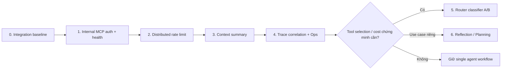

# Kế hoạch hoàn thiện Week 7 — Agent hardening, context và vận hành

> Nguồn yêu cầu: [audit Week 7](../report/week-7-ai-agent-audit.md). Kế hoạch chỉ xử lý các khoảng trống trong audit; không thay mô hình Agent cấp 3 hiện có thành autonomous/multi-agent nếu chưa có bằng chứng eval và use case riêng.

> Trạng thái triển khai: Phase 1–3 và phần metric aggregate của Phase 4 đã được hiện thực. Cần đặt `INTERNAL_MCP_TOKEN` trong `.env`, chạy migration `0014_distributed_rate_limit.sql` qua luồng `db:migrate`, rồi deploy/restart Compose. Phase 5–6 vẫn là thử nghiệm có gate, chưa đưa vào luồng mua hàng.

## 1. Bất biến phải giữ

- Tool write hiện có vẫn bắt buộc đi qua `confirm`/`approve` → `interrupt()` → resume; không chuyển safety boundary sang prompt hoặc router.
- `thread_id`, visitor scope, confirmation/approval ID và quyền tra đơn vẫn do server kiểm soát.
- `ToolMessage` phải luôn ghép đúng với `AIMessage.tool_calls`; summary/window không được để message dang dở lọt vào request model.
- Khi bất kỳ lớp mới nào lỗi, graph vẫn phải có đường lui: guard/small talk hoặc agent hiện tại; không làm website bán hàng ngừng hoạt động.
- External MCP vẫn qua SSRF guard, schema validation, allowlist và approval theo cấu hình hiện có.

## 2. Thứ tự triển khai

Phase 0–4 là P1/P2 vận hành cần làm theo thứ tự. Phase 5–6 là **gated experiments**, mặc định không triển khai trên luồng purchase/order.

## 3. Phase 0 — Integration baseline và acceptance contract

1. Dùng workflow CI đã có ở [`.github/workflows/quality.yml`](../.github/workflows/quality.yml) để chạy DB tests với PostgreSQL; mở rộng fixture nếu cần MCP test service.
2. Chạy staging Compose gồm web/worker/mcp/db, sau đó chạy `pnpm eval:agent` với API key/budget riêng. Lưu artifact theo commit, model, limits và prompts.
3. Chốt hard-fail = 0 cho các ca: write trước duyệt/xác nhận, tra đơn sai chủ, lộ prompt/PII, bịa giá/tồn kho, duplicate write sau resume.
4. Chốt SLO baseline: p95 request, p95 tool, tool-error rate, rate-limit reject rate, model/tool calls mỗi turn, approval/confirmation backlog.

**Bề mặt:** hạ tầng CI/staging. Admin chỉ đọc report/eval; Web không đổi.

## 4. Phase 1 — Internal MCP authentication và health (P1)

### Thiết kế

1. Thêm `INTERNAL_MCP_TOKEN` bắt buộc trong runtime Compose (không render/không cho admin sửa). Lưu theo env/secret manager, không DB admin secrets.
2. Trong `src/mcp/server.ts`:
   - thêm `/health` chỉ trả `{ status: 'ok' }`, không tiết lộ tool/config;
   - bảo vệ `/mcp` bằng constant-time Bearer comparison;
   - từ chối request thiếu/sai token bằng 401 trước khi tạo server/transport.
3. Trong `src/features/agent/gateway.ts`, truyền header token vào `StreamableHTTPClientTransport`; xác nhận API SDK hỗ trợ request headers bằng spike/test. Nếu SDK không hỗ trợ, tạo fetch wrapper hẹp thay vì đặt header global.
4. Trong Docker Compose:
   - service `mcp` healthcheck `/health`;
   - `web`/`worker` phụ thuộc `service_healthy`;
   - token chỉ mount cho web/worker/mcp, không public qua Cloudflare tunnel.
5. Admin → MCP Server: hiển thị built-in server health và lỗi kết nối đã redaction; không hiển thị/cho sửa token nội bộ.

### Test/acceptance

- MCP route không có token/sai token = 401; token đúng vẫn gọi được tool.
- `/health` không cần token và không có tool list/secret.
- Graph hoạt động khi MCP healthy; khi unavailable trả ToolMessage/fallback hiện có, không 500 toàn chat.
- Token không có trong browser response, log, snapshot test hoặc admin API.

## 5. Phase 2 — Distributed rate limiting bằng PostgreSQL (P1)

### Quyết định

Chọn PostgreSQL trước Redis vì basecode đã có PostgreSQL, migration và Compose DB; tránh thêm vận hành Redis cho project hiện tại. Có thể chuyển adapter sang Redis sau nếu load chứng minh cần.

### Thiết kế

1. Thay `src/lib/rate-limit.ts` bằng interface `RateLimitStore`; giữ in-memory implementation cho unit test/local fallback, thêm `PostgresRateLimitStore` dùng upsert/transaction atomic.
2. Migration tạo bucket/record theo `key`, window expiry, count; index expiry và worker cleanup định kỳ. Không lưu raw IP/visitor: key = HMAC server-side của `visitor + IP + action`.
3. Giữ các keys hiện có và bổ sung limit riêng cho:
   - chat message;
   - upload;
   - failed order lookup/phone verification;
   - confirmation/resume và admin auth endpoint.
4. Khi limit hit, giữ HTTP 429 contract; Web chat hiển thị `retryAfterSeconds` rõ ràng thay vì chỉ generic error.
5. Ghi metric aggregate `rate_limit.allowed/rejected` theo action; Admin Monitoring chỉ xem count/rate, không xem key hoặc IP.

### Test/acceptance

- Hai process/store instance cùng key không vượt giới hạn tổng.
- Window expiry reset chính xác; `peek` không consume; burst concurrency không vượt count.
- Không có PII/raw IP trong DB row, log hay monitoring.
- Regression test chat/upload/lookup trả đúng 429 + retry time.

## 6. Phase 3 — Context summary an toàn cho hội thoại dài (P1)

### Thiết kế state

1. Mở rộng `AgentState` bằng `conversationSummary` và metadata summary (message range/version), **không** dùng summary làm source cho giá, stock, order status hay policy.
2. Giữ state facts có cấu trúc hiện có (`verifiedOrders`, `orderId`, `awaiting`, `pendingAction`, `turnSources`) làm nguồn nghiệp vụ; summary chỉ giữ intent, lựa chọn người dùng, câu hỏi dở dang và kết quả giao tiếp không nhạy cảm.
3. Trước mọi window/truncate, chạy normalizer:
   - giữ nguyên đầy đủ cặp AI tool-call ↔ ToolMessage;
   - bỏ/đóng tool call dở dang khi thread cũ bị lỗi hoặc bị cắt;
   - bắt đầu window bằng HumanMessage như `agentHistory()` đang làm.
4. Khi vượt ngưỡng configurable (`AGENT_SUMMARIZE_AFTER_MESSAGES`, `AGENT_KEEP_RECENT_MESSAGES`), graph chạy `summarize` node rồi remove phần cũ an toàn.
5. Summary v1 ưu tiên deterministic structured compaction từ state/messages; nếu cần LLM summarizer, dùng output JSON schema, temperature 0, không bind tool, timeout/fallback `no summary`.
6. Prompt ghi summary trong block data riêng và nhắc model rằng dữ liệu sống luôn phải tool-call lại trong lượt hiện tại.

### Bề mặt cập nhật

- **Backend:** `agent/graph.ts`, `runtime.ts`, state/checkpoint, prompt core và test fake model.
- **Admin → AI Agents:** thêm giới hạn history/summary theo Agent, có guard range và mô tả cost trade-off.
- **Admin → Chat thử:** debug read-only hiển thị summary applied/message count, đã redaction.
- **Web:** không UI mới; câu nối tiếp dài vẫn hiểu được, status streaming giữ nguyên.

### Test/acceptance

- 20+ lượt có tool pairs: request model vẫn hợp lệ, không ToolMessage orphan.
- Restart/resume tại approval/confirmation vẫn exactly-once.
- Summary không biến dữ liệu cũ thành citation/evidence hiện tại; giá/tồn kho vẫn bắt tool call mới.
- Khi summary LLM lỗi/tắt, graph dùng window hiện tại và không fail turn.

## 7. Phase 4 — Distributed trace correlation và vận hành (P2)

Tuần 6 đã thêm Admin Monitoring aggregate; phase này nâng lên trace có thể theo một request xuyên web → graph → gateway → MCP.

1. Chuẩn hoá context `{ trace_id, thread_id_hmac, span_id, parent_span_id }`; `trace_id` tiếp tục do `/api/chat` tạo.
2. Gateway truyền trace context qua MCP `_meta` và external HTTP headers nếu server cho phép; không gửi visitor ID, phone hoặc prompt trong header.
3. Tạo span/event tối thiểu: precheck, model invoke, tool call, approval/confirmation interrupt-resume, retrieval, MCP request, response validation.
4. Mở rộng Admin Monitoring bằng màn trace detail từ log/event redacted; giới hạn retention và access admin.
5. Khi có collector hạ tầng, xuất OpenTelemetry/Prometheus; alerts đặt ngoài app cho MCP/provider error, p95, cost spike và approval backlog.

**Acceptance:** một `trace_id` tra được mọi stage; dashboard không render raw message/tool args/PII; missing telemetry không làm chat failure.

## 8. Phase 5 — Router classifier (P2, chỉ khi có dữ liệu)

### Gate

Chỉ spike nếu ít nhất một trong các điều kiện kéo dài hai release: tool selection sai vượt ngưỡng đã chốt, cost/latency FAQ tăng so baseline, hoặc Agent có quá nhiều scope/tool khiến descriptions không đủ ổn định.

### Thiết kế thử nghiệm

1. Giữ precheck rule hiện có trước mọi LLM. Thêm classifier model nhanh, JSON strict: `chat | rag | shop | out_of_scope`, `standalone_query`, confidence.
2. Fallback JSON/timeout/low confidence → graph agent hiện tại, không tự từ chối hay tự write.
3. `shop` chỉ điều hướng vào cùng graph/tool guard hiện có; router không có quyền gọi tool hay bỏ qua confirmation/approval.
4. Shadow mode trước: ghi route dự đoán + route/tool thực tế, không đổi hành vi. A/B golden set/Chat thử admin rồi mới enable flag.
5. Admin Chat thử hiển thị route/debug cho admin; storefront không hiển thị nhãn route.

### Không làm

- Không regex-router policy/live ở client.
- Không đưa checkout/cancel/exchange return ra khỏi graph hiện tại.

## 9. Phase 6 — Reflection, planning và multi-agent (P2/use-case-specific)

Không thêm vào shopping/order flow. Chỉ tạo capability riêng khi có owner, golden set và budget:

| Mẫu | Use case hợp lệ | Guardrail bắt buộc |
| --- | --- | --- |
| Reflection | Draft nội dung marketing/FAQ dài | tối đa 2 vòng, critic schema, không tool write |
| Planning | Báo cáo vận hành nhiều bước chỉ đọc | kế hoạch xem/duyệt trước, max step/cost, tool read-only |
| Multi-agent | Research độc lập, không transaction | sub-agent context riêng, output structured, manager không có write tool |

Admin tạo agent/capability riêng và gán quyền tối thiểu; Web phải hiển thị như tác vụ riêng, không chen vào chat mua hàng mặc định.

## 10. Rollout và rollback

1. Deploy MCP auth ở chế độ dual-read ngắn hạn (accept old+new credential ở server nội bộ), cập nhật web/worker, xác nhận health, rồi bỏ credential cũ.
2. Rate limit Postgres chạy shadow count trước, so với in-memory, sau đó switch bằng feature flag; rollback về in-memory chỉ dùng khi single replica và có incident note.
3. Summary enable trước cho admin Chat thử, rồi canary 5–10% thread mới; disable flag sẽ quay lại window hiện tại, checkpoint cũ vẫn đọc được.
4. Router chỉ shadow/A-B trước; rollback = tắt flag, không migration state.
5. Mọi rollout phải có eval artifact và dashboard snapshot; không rollout đồng thời router + summary + model change.

## 11. Checklist PR

- Không lộ token MCP, raw tool args, PII hoặc prompt trong log/UI/test fixture.
- Authorization, schema validation, idempotency và HITL được kiểm lại sau mọi thay đổi graph/router.
- Có fake-model graph test và DB/integration test cho nhánh mới; test restart/resume luôn có.
- `pnpm lint`, `pnpm typecheck`, `pnpm test` xanh; staging `eval:agent` chạy cho thay đổi P1/release.
- Có metric/trace outcome và fallback test cho mọi network dependency mới.

