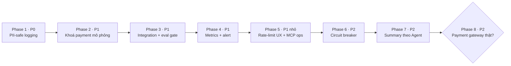

# Kế hoạch Week 8 — Hoàn thiện production readiness

> Nguồn yêu cầu: [audit Week 8](../report/week-8-case-study-audit.md). Kế hoạch này chỉ xử lý những phần **chưa áp dụng hoặc mới áp dụng một phần**. Nó tiếp nối [plan Week 7](./week-7-agent-hardening-plan.md) và không làm lại các phase Week 7 đã xong.

> **Trạng thái:** Phase 1–7 đã triển khai và có test (05-11-2026, chưa commit): `test:ci` chạy với Postgres cho 415/415 pass, 0 bị skip; `pnpm build` thành công. Hai workflow GitHub và profile Compose `observability` **chưa chạy thử thật** (đã validate config Compose và `promtool check rules`). Khi deploy sẽ chạy migration `0015_alert_events.sql` và `0016_agent_history_settings.sql`. Xoá log cũ là bước vận hành thủ công (xem README). **Phase 8 chưa bắt đầu, đúng theo gate:** cần nhà cung cấp thanh toán cụ thể và sandbox credential.

## 1. Đối chiếu lại audit với code hiện tại

Audit được viết trước khi các thay đổi Week 7 (chưa commit) hoàn tất, nên một số finding đã được xử lý. Bảng dưới đây là hiện trạng thực tế dùng làm đầu vào cho plan.

| Finding audit | Đã có trong code | Còn thiếu (phạm vi plan này) |
| --- | --- | --- |
| **P0** PII trong log MCP | `handler()` ở [mcp/server.ts](../src/mcp/server.ts) không còn log `args` | Chưa có module redact chung. `chat.received` vẫn log câu hỏi, chỉ che email và chuỗi 9+ chữ số liền nhau, nên SĐT có dấu cách (`0912 345 678`), tên và địa chỉ vẫn lộ ([chat/route.ts:17](../src/app/api/chat/route.ts#L17)). Các field `error: message` (MCP, external MCP, stream, graph) có thể chứa input của khách. `threadId` được log dạng raw ([session.ts:140](../src/features/agent/session.ts#L140), [session.ts:183](../src/features/agent/session.ts#L183)). Logger không cấu hình `redact`. Chưa có test chứng minh PII không xuất hiện trong log. Log cũ trên đĩa có thể đã chứa PII. |
| **P1** MCP auth và health | Bearer so sánh constant-time ([internal-auth.ts](../src/mcp/internal-auth.ts)), `/health`, Compose `service_healthy` | Admin → MCP Server chưa hiển thị health của server built-in. Chưa hỗ trợ xoay vòng token (rotation). Token vẫn có thể được suy ra từ `ADMIN_SESSION_SECRET`. |
| **P1** Rate limit chỉ dùng memory | `PostgresRateLimitStore`, migration `0014`, Compose đặt `RATE_LIMIT_BACKEND=postgres`, có key cho tra đơn thất bại, confirm, admin login, MCP test | Phản hồi 429 không trả `retryAfterSeconds` hay header `Retry-After` ([shop-api.ts:17](../src/lib/shop-api.ts#L17)), và chat widget không hiện thời gian chờ. Khi thiếu `ADMIN_SESSION_SECRET`, HMAC rơi về khoá hằng `fashion-rate-limit-local-key`. Các API ghi của admin (sửa sản phẩm, agent, đơn) chưa có limit. |
| **P1** Observability | Trang Admin Monitoring tổng hợp từ NDJSON ([monitoring/summary.ts](../src/features/monitoring/summary.ts)): p95 chat/retrieval, empty rate, token, rate-limit | Chưa có metric theo từng tool (latency, error rate), backlog approval/confirmation, health MCP và cảnh báo (alert). `providerErrors` đang đếm mọi stage chứa `failed`/`error`, quá rộng. Chưa có exporter (Prometheus/OTel). |
| **P1** Integration gate | [quality.yml](../.github/workflows/quality.yml) chạy lint, typecheck, test với Postgres | CI chưa đặt `INTERNAL_MCP_TOKEN` và chưa kiểm rằng DB test thật sự chạy (không bị skip). `eval:rag` và `eval:agent` chỉ ghi file kết quả, **không trả exit code ≠ 0** khi có hard-fail, nên chưa dùng làm gate được. Chưa có workflow staging/release eval. |
| **P2** Summary hội thoại | Node `summarize` kiểu deterministic, đã redact, có flag `AGENT_SUMMARY_ENABLED`/`AGENT_SUMMARIZE_AFTER_MESSAGES`/`AGENT_KEEP_RECENT_MESSAGES` | Ngưỡng summary chỉ đặt được qua env, chưa đặt được theo từng Agent trong Admin. Chưa có test 20+ lượt kèm cặp tool call, chưa có test tool call bị cắt dở. Chat thử chưa hiển thị debug summary. |
| **P2** Circuit breaker và retry | OpenAI có `timeout` + `maxRetries` (SDK); MCP có timeout | Chưa có circuit breaker, retry kèm jitter cho tool đọc, và trạng thái “dịch vụ tạm gián đoạn” trả cho khách. |
| **P2** Thanh toán mô phỏng | `payCustomerOrder` có lock và idempotent khi đã `paid` | **Rủi ro mới phát hiện:** `POST /api/orders/[code]/pay` cho phép chính khách gửi `outcome: 'success'` để tự đánh dấu đơn đã thanh toán ([customer-orders.ts:109](../src/features/orders/customer-orders.ts#L109)). Endpoint này phải bị tắt ở production. Chưa có gateway thật, webhook và đối soát (reconciliation). |

Ngoài phạm vi: “Router/guardrail giá rẻ chạy trước” vẫn theo Phase 5 của plan Week 7 (một thử nghiệm có gate, chỉ làm khi có dữ liệu chứng minh cần).

## 2. Bất biến phải giữ

Các bất biến trong audit mục “Bất biến phải giữ khi sửa code” vẫn áp dụng. Plan này bổ sung thêm:

- Logging, metrics, breaker và alert **không được làm hỏng một lượt chat**. Mọi lỗi telemetry đều được nuốt (fail-open cho quan sát), còn auth/HITL vẫn fail-closed.
- Retry tự động **chỉ áp dụng cho thao tác đọc**. Tool ghi (`add_to_cart`, `set_cart_quantity`, `checkout`, `cancel_order`, `create_*_request`, external tool cần duyệt) không được retry ngầm.
- Không có metric label nào chứa ID khách, SĐT, IP, `thread_id` raw hoặc nội dung câu hỏi.

## 3. Thứ tự triển khai

Phase 1–5 là điều kiện **trước production**. Phase 6–7 thuộc production baseline. Phase 8 chỉ bắt đầu khi có nhà cung cấp thanh toán thật và Phase 3 đã chặn được release.

| Phase | Ước lượng | Bề mặt chính |
| --- | --- | --- |
| 1. PII-safe logging | M | Backend, test |
| 2. Khoá payment mô phỏng | S | Backend, Web |
| 3. Integration + eval gate | M | CI, scripts |
| 4. Metrics + alert | M–L | Backend, Admin, Compose |
| 5. Rate-limit UX + MCP ops | S–M | Backend, Web, Admin |
| 6. Circuit breaker | M | Backend, Web, Admin |
| 7. Summary theo Agent | S–M | Backend, Admin, DB |
| 8. Payment gateway | L | Backend, Web, Admin, DB |

## 4. Phase 1 — PII-safe logging (P0)

### Thiết kế

1. Tạo `src/lib/redact.ts` làm nguồn duy nhất cho việc che dữ liệu:
   - `redactText(text)`: che email, SĐT Việt Nam kể cả có dấu cách/chấm/gạch/ngoặc (`(?:\+?84|0)\d[\d .()-]{7,}`), chuỗi số 9+ chữ số và số thẻ/tài khoản. Gom `redactForTrace` ([chat/route.ts](../src/app/api/chat/route.ts)) và `redactSummaryText` ([graph.ts](../src/features/agent/graph.ts)) về đây.
   - `safeError(error)`: lấy `message`, chạy `redactText`, cắt còn 300 ký tự, giữ `name`/`code`. Không log stack trace của lỗi có input khách ở mức `info`.
   - `ref(id)`: HMAC-SHA256 rút gọn (16 hex) với khoá server, dùng để liên kết log của cùng một thread/visitor mà không lộ ID gốc. Tái sử dụng cách băm của `bucketKey` trong [rate-limit.ts](../src/lib/rate-limit.ts).
2. Áp dụng tại các điểm log:
   - `chat.received`: **bỏ hẳn nội dung câu hỏi**, chỉ log `questionChars`, `threadRef`. Nếu cần debug nội dung thì dùng flag `LOG_CHAT_TEXT=true` (mặc định `false`), và kể cả khi bật vẫn đi qua `redactText`.
   - `session.ts`, `confirmations/[id]/route.ts`: đổi `threadId` thành `threadRef`. `approvalId`/`confirmationId` là ID nội bộ, không phải PII, nên được giữ.
   - Mọi field `error:` trong [mcp/server.ts](../src/mcp/server.ts), [mcp/external.ts](../src/features/mcp/external.ts), [chat/stream.ts](../src/app/api/chat/stream.ts), [graph.ts](../src/features/agent/graph.ts), [decision-route.ts](../src/features/agent/decision-route.ts), [servers.ts](../src/features/mcp/servers.ts) và worker đi qua `safeError`.
3. Lớp phòng thủ thứ hai trong [logger.ts](../src/lib/logger.ts): cấu hình `pino({ redact: { paths: [...], censor: '[redacted]' } })` cho `args`, `*.phone`, `*.address`, `*.customer_name`, `*.email`, `question`, `message`, `payload.*`. Nếu sau này có ai lỡ log nguyên object thì các field này vẫn bị che.
4. Kết quả tool trả cho model (ToolMessage) không bị ảnh hưởng: model vẫn cần dữ liệu đơn hàng. Redact chỉ áp dụng cho log và trace.
5. Dọn dữ liệu cũ: thêm bước vận hành (runbook) để xoá hoặc xoay vòng `data/logs/*.ndjson*` sau khi deploy, vì log trước bản sửa có thể chứa câu hỏi chưa che.

### Test/acceptance

- Unit test `redact.test.ts` với bảng ca: `0912345678`, `0912 345 678`, `+84 912.345.678`, `(091) 234-5678`, email, số tài khoản 12 chữ số. Ca không được che nhầm: mã đơn `FT-2026-1001`, mã sản phẩm `SM-001`, giá `799.000đ`.
- Test tích hợp log: thay destination của pino bằng buffer, chạy một lượt graph với fake model/gateway, trong đó khách nhắn SĐT, địa chỉ và email; gọi `verify_order` và `checkout` có lỗi. Assert buffer **không chứa** chuỗi SĐT (cả dạng có dấu cách), email hay địa chỉ.
- Test `mcp/server` handler: khi tool ném lỗi chứa SĐT, log chỉ có `[phone]`.
- Thêm lint hoặc test tĩnh: grep `logger.*(args|body|request.json)` trong `src/` và fail nếu khớp.

**Bề mặt:** Backend và hạ tầng. Admin Monitoring chỉ đọc dữ liệu đã che. Web không đổi.

### Đã triển khai (Phase 1)

- [src/lib/redact.ts](../src/lib/redact.ts): `redactText`, `safeError`, `ref`, `LOG_REDACT_PATHS`. `redactSummaryText` trong graph giờ dùng `redactText`, và `redactForTrace` trong chat route đã bị bỏ.
- [src/lib/logger.ts](../src/lib/logger.ts): bật `redact` của pino và export `createLogger(destination)` để test.
- [src/features/chat/trace.ts](../src/features/chat/trace.ts): `chat.received` chỉ ghi `threadRef` + `questionChars`; `LOG_CHAT_TEXT=true` mới thêm `questionRedacted`.
- `handler()` được tách sang [src/mcp/handler.ts](../src/mcp/handler.ts) để test mà không phải mở cổng HTTP.
- 13 chỗ log lỗi chuyển sang `safeError`. `session.ts` log `threadRef` thay cho `threadId`.
- [tests/log-redaction.test.ts](../tests/log-redaction.test.ts) (21 test): bảng regex, pino redaction, MCP handler, hai lượt graph (tool lỗi và provider lỗi có SĐT/email/địa chỉ) và test tĩnh quét các call site của logger.
- Khác plan: không cần lint rule riêng, vì test tĩnh trong vitest đã đảm nhận việc kiểm tra call site.

## 5. Phase 2 — Khoá endpoint thanh toán mô phỏng (P1, phát hiện mới)

### Thiết kế

1. Thêm env `PAYMENT_SIMULATION_ENABLED` (mặc định `true` ở dev, Compose production đặt `false`).
2. Khi flag tắt, `POST /api/orders/[code]/pay` trả `404`/`410`, và UI đơn hàng ẩn nút “Thanh toán (mô phỏng)”. Thay bằng thông báo “Đơn sẽ được xác nhận khi cổng thanh toán báo về” hoặc chỉ cho chọn COD.
3. Ghi audit `payment.simulation_blocked` (không kèm PII) khi có request bị chặn.
4. Ghi rõ trong README: đây là một **giới hạn có chủ đích** cho tới khi xong Phase 8.

### Test/acceptance

- Khi flag tắt, khách sở hữu đơn gửi `outcome: 'success'` thì nhận 404/410, và `payment_status` không đổi.
- Khi flag bật, hành vi hiện tại vẫn pass các test hiện có.

**Bề mặt:** Backend, Web (trang đơn/checkout). Admin không đổi.

### Đã triển khai (Phase 2)

- **Khác plan:** flag mặc định là `false` ở **mọi** môi trường (fail-closed) thay vì `true` ở dev; vitest đặt `true` để test cũ giữ nguyên.
- **Khác plan:** chỉ tắt `/pay` là chưa đủ. Admin không giao được đơn online chưa thanh toán, nên đơn đó sẽ kẹt. Vì vậy khi tắt mô phỏng, **checkout chỉ nhận COD**:
  - [payment-availability.ts](../src/features/orders/payment-availability.ts) quyết định phương thức nào dùng được;
  - `checkout()` kiểm sau bước replay (retry đơn cũ vẫn trả lại đơn đó);
  - graph từ chối với mã `payment_unavailable` **trước** khi tạo confirmation;
  - form checkout chỉ hiện COD.
- `payCustomerOrder` trả 404 trước khi kiểm quyền sở hữu, và ghi audit `payment.simulation_blocked`. `canPay` = false. Đơn online cũ hiện ghi chú “thanh toán online đang tạm ngưng”, khách vẫn hủy được.
- Sửa thêm lỗi có sẵn: `z.coerce.boolean()` coi chuỗi `"false"` là `true`. Đã thay bằng `envFlag()` cho mọi biến boolean trong env; giá trị không hợp lệ sẽ báo lỗi ngay khi khởi động.
- Test: [payment-availability.test.ts](../tests/payment-availability.test.ts) (envFlag, availability, graph) và một ca DB mới trong [shop.db.test.ts](../tests/db/shop.db.test.ts).

## 6. Phase 3 — Integration và eval gate (P1)

### Thiết kế

1. **CI chắc chắn chạy DB test** trong [quality.yml](../.github/workflows/quality.yml):
   - đặt `INTERNAL_MCP_TOKEN`, `ADMIN_SESSION_SECRET` giả (secret riêng của CI) và `RATE_LIMIT_BACKEND=postgres`;
   - chạy `pnpm db:migrate` với `TEST_DATABASE_URL` trước `pnpm test`, nếu test chưa tự migrate;
   - thêm env `REQUIRE_DB_TESTS=1`: khi đặt, helper skip của DB test chuyển sang **fail** thay vì skip, nên CI không thể âm thầm bỏ qua 129 test.
2. **Eval có exit code**: [eval-agent.ts](../src/scripts/eval-agent.ts) và [eval-rag.ts](../src/scripts/eval-rag.ts):
   - thêm cờ `--gate`: `process.exitCode = 1` nếu `hardFail > 0`, hoặc nếu metric chính thấp hơn baseline quá ngưỡng cho phép (ví dụ citation accuracy, tool accuracy giảm hơn 3 điểm %);
   - baseline lưu trong `evals/baseline.json` (commit vào repo) và chỉ được cập nhật qua PR có review;
   - file kết quả ghi thêm `commit`, `model`, `agentId`, `maxSteps`/`maxToolCalls`, hash của core prompt.
3. **Workflow `release-eval.yml`** (`workflow_dispatch` + tag `v*`):
   - dựng Compose staging (db + mcp + web + worker), seed, rồi chạy `eval:rag --gate` và `eval:agent --gate` với `OPENAI_API_KEY` từ GitHub secret và budget riêng;
   - upload `data/eval-results/*.json` làm artifact;
   - release chỉ được gắn tag sau khi job này xanh (dùng branch protection hoặc environment approval).
4. *(Tuỳ chọn)* Admin → **Evals**: trang chỉ đọc, liệt kê file trong `data/eval-results` (thời gian, commit, pass/fail, hard-fail) và cho xem chi tiết từng ca đã redact.

### Test/acceptance

- PR có DB test bị skip thì CI đỏ.
- Cố tình làm hỏng approval gate trong một nhánh thử thì `eval:agent --gate` trả exit 1.
- Artifact eval truy được commit và model.

**Bề mặt:** CI/hạ tầng, scripts. Admin có màn Evals (tuỳ chọn). Web không đổi.

### Đã triển khai (Phase 3)

- [quality.yml](../.github/workflows/quality.yml): sửa lỗi có sẵn là `setup-node` dùng `cache: pnpm` trước khi pnpm được cài (thêm `pnpm/action-setup`). Chạy `pnpm test:ci` với `REQUIRE_DB_TESTS=1`.
- `REQUIRE_DB_TESTS=1` mà thiếu `TEST_DATABASE_URL` thì [global setup](../tests/setup/require-db.ts) fail ngay.
- `test:ci` ghi báo cáo JSON, và [check-test-report.ts](../src/scripts/check-test-report.ts) fail nếu có test bị skip hoặc todo.
- [eval-gate.ts](../src/scripts/eval-gate.ts) chứa các hàm thuần `gateAgent`/`gateRag`, ngưỡng lấy từ [evals/baseline.json](../evals/baseline.json). Kết quả gate luôn được ghi vào file kết quả; `--gate` mới biến kết quả fail thành exit 1.
- [eval-meta.ts](../src/scripts/eval-meta.ts): file kết quả ghi `commit`, `dirty`, Agent mặc định (model, giới hạn, hash instructions; lấy từ DB chứ không còn từ env), và hash của core prompt.
- [eval-ready.ts](../src/scripts/eval-ready.ts) (`pnpm eval:ready`): chờ các ingestion job chạy xong, và fail nếu có tài liệu chưa `ready`.
- [release-eval.yml](../.github/workflows/release-eval.yml): Compose staging, rồi seed, ready, hai gate, upload artifact. Release chỉ được tạo khi cả hai gate xanh.
- **Khác plan:** chưa làm màn Admin → Evals (mục tuỳ chọn); hard-fail theo nhóm case; baseline Agent lấy từ kết quả 34 case trong khi golden set nay có 46 case, nên cần cập nhật sau lần chạy staging đầu tiên.
- Test: [eval-gate.test.ts](../tests/eval-gate.test.ts) (9 ca, gồm cả việc kiểm baseline với kết quả Week 7 đã nộp).

## 7. Phase 4 — Metrics và alert (P1)

### Quyết định

Làm hai lớp:

- **4a**: in-app, không thêm hạ tầng. Mở rộng Admin Monitoring đang có.
- **4b**: exporter Prometheus cùng Grafana/Alertmanager chạy trong Compose profile `observability`. Chỉ bật profile này khi deploy thật.

Như vậy dự án học tập vẫn chạy được mà không cần thêm service, còn đường lên production đã rõ ràng.

### 4a — In-app

1. Chuẩn hoá stage log để đếm chính xác hơn: thêm field `outcome: 'ok' | 'error' | 'timeout' | 'rejected'` và `dependency: 'openai' | 'mcp_builtin' | 'mcp_external' | 'db'`. Thay heuristic `stage.includes('failed')` bằng phép đếm theo `dependency` + `outcome`.
2. Mở rộng [monitoring/summary.ts](../src/features/monitoring/summary.ts):
   - p95 latency và error rate **theo từng tool** (stage `mcp.tool`, `mcp.external_tool`);
   - p95 thời gian gọi model, số model/tool call trung bình mỗi lượt, ước tính chi phí token theo bảng giá cấu hình;
   - guard rate (`guardrail.prompt_injection`), tỉ lệ `limit` route, tỉ lệ citation bị từ chối.
3. Đọc trực tiếp từ DB (không qua log): số approval đang `pending` và tuổi của approval cũ nhất, số confirmation đang chờ, số ingestion job lỗi.
4. Worker thêm job `alerts` chạy mỗi 5 phút. Job so ngưỡng (`ALERT_*` trong env) cho: provider error rate, p95 chat, approval cũ hơn N giờ, MCP health fail, eval gate gần nhất fail. Khi vượt ngưỡng thì ghi log `alert.fired`, và nếu có `ALERT_WEBHOOK_URL` thì gửi webhook (Slack/Discord) với payload **chỉ chứa số liệu**. Có chống gửi lặp (dedupe) theo khoá alert + cửa sổ thời gian.
5. Monitoring hiển thị danh sách alert gần đây và trạng thái MCP/circuit (lấy từ Phase 5/6).

### 4b — Exporter

1. Thêm `prom-client`. Web và MCP mỗi bên expose `/metrics` trên **cổng nội bộ riêng hoặc yêu cầu Bearer token**. Không đi qua Cloudflare tunnel.
2. Danh sách metric: `chat_turn_duration_seconds`, `model_call_duration_seconds{model,outcome}`, `tool_call_duration_seconds{tool,source,outcome}`, `retrieval_duration_seconds`, `retrieval_empty_total`, `rate_limit_total{action,outcome}`, `approval_pending`, `confirmation_pending`, `tokens_total{kind}`, `circuit_state{dependency}`. Label không chứa ID.
3. Compose profile `observability`: Prometheus, Grafana (dashboard JSON provision sẵn) và file alert rules tương ứng với ngưỡng ở 4a.

### Test/acceptance

- Unit test summary với log fixture: đếm đúng theo tool/outcome, bỏ qua dòng log hỏng.
- Test alert: vượt ngưỡng thì gửi đúng một webhook; lặp lại trong cửa sổ dedupe thì không gửi thêm; webhook lỗi thì worker không crash.
- Snapshot `/metrics`: không có label chứa UUID/SĐT.

**Bề mặt:** Backend, worker, Compose. Admin có Monitoring mở rộng và link Grafana. Web không đổi.

### Đã triển khai (Phase 4)

- **Telemetry** ([telemetry.ts](../src/lib/telemetry.ts)): `trackDependency` ghi một dòng `dependency.call` và một histogram cho mỗi lần gọi OpenAI (graph), MCP nội bộ (gateway) và MCP ngoài. Các outcome:
  - `ok`;
  - `tool_error`: MCP trả `isError`, là lỗi nghiệp vụ, không tính là sự cố;
  - `failed`, `timeout`;
  - `aborted`: khách rời đi.
- **Metrics** ([metrics.ts](../src/lib/metrics.ts)): registry `prom-client` giữ trên `globalThis`. Đo lượt chat, dependency, retrieval, rate limit, token, guard, kết quả trả lời, và các gauge backlog đọc từ DB lúc scrape. Endpoint [/api/metrics](../src/app/api/metrics/route.ts) cần `METRICS_TOKEN`; không đặt token thì trả 404.
- **Monitoring** ([summary.ts](../src/features/monitoring/summary.ts)): hàm thuần `summarize` cộng `readLogLines(window)` lọc theo `time`. `providerErrors` được thay bằng số lỗi theo từng dependency. [backlog.ts](../src/features/monitoring/backlog.ts) đọc trực tiếp từ DB.
- **Alerts** ([alerts.ts](../src/features/monitoring/alerts.ts)): hàm thuần `evaluateAlerts` đánh giá luật; worker chạy `runAlertChecks`. Chống gửi lặp nằm ngay trong câu lệnh `INSERT … WHERE NOT EXISTS` trên bảng `alert_events` (migration 0015). Webhook gửi cả `text` (Slack) lẫn `content` (Discord); nếu webhook lỗi, alert vẫn được ghi lại.
- **Compose profile `observability`**: Prometheus v2.53.0 (token ghi ra file trong container), 5 alert rules, và Grafana 11.1.0 (127.0.0.1:3002) với datasource và dashboard 12 panel đã provision sẵn.
- **Khác plan:**
  - MCP server không có `/metrics` riêng: web đo từng lần gọi MCP từ đầu đến cuối, còn health MCP do worker kiểm;
  - không dùng Alertmanager: thông báo đi qua webhook của worker, rule Prometheus chỉ để xem;
  - chưa có metric `circuit_state` (thuộc Phase 6).
- **Test:** [monitoring.test.ts](../tests/monitoring.test.ts) (13 ca: summarize, cửa sổ log, luật alert, eval gate, telemetry, endpoint metrics khi DB down) và [alerts.db.test.ts](../tests/db/alerts.db.test.ts) (fire, chống gửi lặp, gửi lại sau khi hết cửa sổ, webhook lỗi).

## 8. Phase 5 — Rate-limit UX và vận hành MCP (P1 nhỏ)

### Rate limit

1. `guardWrite` và `/api/chat` trả JSON `{ error, retryAfterSeconds }` kèm header `Retry-After`. Thêm `retryAfterSeconds` vào `HttpError`.
2. [chat-widget.tsx](../src/components/shop/chat-widget.tsx) và các form shop: khi nhận 429, hiển thị “Bạn gửi hơi nhanh, thử lại sau X giây”, khoá nút gửi và đếm ngược.
3. Fail-closed khoá HMAC: khi `RATE_LIMIT_BACKEND=postgres` mà thiếu `ADMIN_SESSION_SECRET`/`RATE_LIMIT_SECRET` thì báo lỗi lúc khởi động thay vì dùng khoá hằng.
4. Thêm limit `admin-write:<ip>` cho các route mutation trong `src/app/api/admin/**` (mức rộng, ví dụ 120/phút) để chống script lỗi hoặc session bị chiếm.

### MCP built-in

1. Admin → MCP Server: với server `is_builtin`, gọi `/health` (timeout ngắn) và hiển thị trạng thái, độ trễ, lỗi gần nhất (đã qua `safeError`). Không bao giờ hiển thị token.
2. Xoay vòng token: server chấp nhận `INTERNAL_MCP_TOKEN` và `INTERNAL_MCP_TOKEN_PREVIOUS` trong giai đoạn chuyển đổi; client chỉ gửi token mới. Viết runbook xoay vòng trong README.
3. Ở production (`NODE_ENV=production`), bắt buộc `INTERNAL_MCP_TOKEN` riêng và bỏ fallback derive từ `ADMIN_SESSION_SECRET`. Fallback chỉ giữ cho dev.

### Test/acceptance

- 429 có `Retry-After` và `retryAfterSeconds` khớp nhau; widget hiển thị đếm ngược (test component hoặc e2e thủ công).
- MCP chấp nhận cả hai token khi có `_PREVIOUS`, và từ chối token cũ sau khi bỏ biến này.
- Admin MCP hiển thị “Không kết nối” khi container MCP dừng, và trang không bị 500.

**Bề mặt:** Backend, Web (thông báo cooldown), Admin (health MCP).

### Đã triển khai (Phase 5)

- **429 thống nhất** (`rateLimitError`/`tooManyRequests` trong [http.ts](../src/lib/http.ts)): thông báo kèm thời gian chờ ("42 giây", "3 phút"), field `retryAfterSeconds` và header `Retry-After`. Áp dụng cho mọi route có rate limit (shop, chat, xác nhận, tra đơn, admin upload/MCP/login).
- **UI:**
  - hook [use-cooldown.ts](../src/components/shop/use-cooldown.ts) và `retryAfterOf()` trong `shop-client`;
  - khung chat khoá ô gửi và hiện đếm ngược;
  - form tra đơn, đặt hàng, thanh toán, huỷ đơn khoá nút "Thử lại sau Ns".
- **Rate limit cho API admin:** đặt trong `requireAdmin()`, chỉ chạy sau khi phiên hợp lệ, `ADMIN_API_RATE_LIMIT`/phút theo IP. Áp dụng cho mọi phương thức (kể cả GET), nên không phải sửa 29 route.
- **Khoá HMAC của bucket:** dùng `RATE_LIMIT_SECRET`, nếu không có thì `ADMIN_SESSION_SECRET`. Với backend `postgres` mà thiếu cả hai thì báo lỗi, thay vì dùng khoá hằng.
- **MCP:**
  - `INTERNAL_MCP_TOKEN_PREVIOUS` cho phép xoay vòng token (runbook trong README);
  - log `mcp.started` ghi `tokenSource`;
  - panel [BuiltinMcpHealth](../src/components/admin/builtin-mcp-health.tsx) trong Admin → MCP Server (có sẵn): /health, nguồn token (không hiện giá trị), số lần gọi và lỗi trong 24 giờ, lỗi gần nhất đã che.
- **Khác plan:** **chưa bỏ** fallback token suy ra ở production, chỉ cảnh báo. Lý do: `.env` hiện tại không có `INTERNAL_MCP_TOKEN`; ngoài ra web chạy `NODE_ENV=production` còn MCP chạy `tsx` thì không, nên rẽ nhánh theo `NODE_ENV` sẽ làm hai bên lệch token. Sẽ bỏ fallback khi mọi môi trường đã đặt token riêng.
- **Test:** [rate-limit-ux.test.ts](../tests/rate-limit-ux.test.ts) (10 ca).

## 9. Phase 6 — Circuit breaker và retry (P2)

### Thiết kế

1. Tạo `src/lib/resilience.ts`:
   - `withRetry(fn, { attempts: 2, baseMs: 200, maxMs: 1500, jitter: 'full', retryOn })`: chỉ retry khi lỗi mạng, timeout hoặc 5xx/429 từ provider;
   - `CircuitBreaker({ key, failureThreshold: 5, windowMs: 30_000, openMs: 30_000, halfOpenMax: 1 })`, trạng thái `closed → open → half_open`. Trạng thái lưu **trong từng process**: breaker vốn mang tính cục bộ, và không cần đồng bộ qua DB.
2. Áp dụng:
   - **OpenAI chat** (`runtime.ts` `invoke`): bọc breaker `openai:chat`. Đặt `maxRetries` của SDK về 0 để không retry hai lớp chồng nhau, và để `withRetry` đảm nhận. Khi breaker mở, graph **không gọi model**, trả câu cố định “Trợ lý đang tạm gián đoạn, bạn thử lại sau ít phút hoặc liên hệ nhân viên” với route `unavailable` và ghi trace.
   - **Embedding** trong retrieval và `search_products` semantic: breaker `openai:embedding`. Khi mở, chuyển sang tìm theo từ khoá (đường lui `semantic_unavailable` đã có).
   - **MCP built-in** (`gateway.ts`): breaker `mcp:builtin`. Chỉ retry tool đọc (`lookup_*`, `search_*`, `view_cart`, `verify_order`). Tool ghi chỉ có timeout, không retry.
   - **External MCP** (`external.ts`): breaker theo `mcp:<slug>`. Khi mở, trả ToolMessage “tool tạm không khả dụng” để model trả lời bằng nguồn khác hoặc báo khách.
3. Web chat nhận event trạng thái `unavailable` và hiển thị banner “Trợ lý tạm gián đoạn” thay vì spinner chờ timeout.
4. Mỗi lần breaker đổi trạng thái thì ghi log `circuit.state_changed` và metric `circuit_state` (Phase 4). Admin Monitoring hiển thị trạng thái hiện tại.

### Test/acceptance

- Test với fake clock: 5 lỗi thì breaker mở; trong lúc mở thì không gọi `fn`; sau `openMs` thì half-open; thành công thì đóng lại.
- Graph test: model breaker mở thì lượt chat kết thúc với câu cố định, `modelCalls = 0`, và không có ToolMessage mồ côi.
- Tool ghi lỗi thì được gọi đúng **1 lần** (không retry). Tool đọc lỗi tạm thời thì retry và thành công.
- Restart/resume approval khi breaker MCP mở: approval vẫn `approved` chờ, không bị đánh dấu thất bại; lần resume sau khi breaker đóng thì ghi đúng một lần.

**Bề mặt:** Backend. Web có banner gián đoạn. Admin Monitoring hiển thị trạng thái circuit.

### Đã triển khai (Phase 6)

- [resilience.ts](../src/lib/resilience.ts):
  - `CircuitBreaker` có các trạng thái closed → open → half_open, đếm lỗi trong một cửa sổ thời gian, và chỉ cho `halfOpenMax` lời gọi thử khi half_open;
  - chế độ `CIRCUIT_BREAKER_MODE` = `off` / `observe` (mặc định) / `enforce`;
  - registry đặt trên `globalThis`, mỗi lần đổi trạng thái ghi log `circuit.state_changed` và gauge `fashion_circuit_state`;
  - `withRetry` (full jitter) chỉ retry khi dependency sự cố thật; không retry `tool_error`, `aborted` hay `CircuitOpenError`.
- Các điểm áp dụng:
  - **`openai:chat`** (graph): khi mở, node `agent` trả `unavailableAnswer()` (route `unavailable`) mà không gọi model; web hiện banner màu vàng.
  - **`openai:embedding`** (`embedGuarded` trong retrieval, chạy trong tiến trình MCP): `search_products` rơi về tìm theo từ khoá, còn scope tool báo lỗi tool cho model. Embedding cũng được ghi thành dependency `openai/embedding` (không tính vào p95 của model).
  - **`mcp:builtin`** (`guardedToolCall` trong gateway): retry 1 lần chỉ cho `lookup_product`, `lookup_order`, `search_products`, `search_knowledge`, `view_cart`.
  - **`mcp:<slug>`** (MCP ngoài): không retry; khi breaker mở thì trả 503 với thông báo rõ ràng.
- Admin Monitoring có panel trạng thái breaker (của tiến trình web); Prometheus có rule `CircuitOpen`; Grafana có thêm panel state-timeline.
- **Khác plan:**
  - Không đặt `maxRetries` của SDK OpenAI về 0 và không bọc thêm `withRetry` cho model. SDK vẫn retry (`OPENAI_MAX_RETRIES`), breaker nằm ở ngoài, nên không có hai lớp retry chồng nhau.
  - `verify_order` không retry, vì một lần tra sai SĐT làm tăng bộ đếm giới hạn tra cứu.
  - Mặc định `observe` đúng theo kế hoạch rollout: muốn chặn thật phải đặt `CIRCUIT_BREAKER_MODE=enforce`.
- **Test:** [resilience.test.ts](../tests/resilience.test.ts) (10 ca), gồm: lúc mở không gọi dependency, half-open, chế độ observe, retry chỉ cho tool đọc, ghi và `verify_order` chỉ gọi 1 lần, và graph trả `unavailable` mà mọi tool call vẫn có ToolMessage tương ứng.

## 10. Phase 7 — Summary theo Agent và test hội thoại dài (P2)

### Thiết kế

1. Migration `0015_agent_history_settings.sql`: thêm `summary_enabled boolean`, `summarize_after_messages int`, `keep_recent_messages int` vào bảng agent (nullable, null nghĩa là dùng env). Có CHECK range (`keep_recent ≥ 4`, `summarize_after > keep_recent`).
2. `AgentRuntimeConfig` đọc các field này. Node `summarize` và `historyStart` dùng giá trị của Agent thay cho env.
3. Admin → AI Agent: thêm nhóm “Lịch sử hội thoại” kèm mô tả đánh đổi chi phí/ngữ cảnh. Chat thử hiển thị (chỉ đọc) summary đang áp dụng và số message đã gộp.
4. Giữ summary deterministic. Chỉ cân nhắc summarizer LLM (JSON schema, temperature 0, không bind tool, fallback “không summary”) nếu eval hội thoại dài cho thấy mất ngữ cảnh.

### Test/acceptance

- Hội thoại 25 lượt có xen `search_products`, `add_to_cart` và `verify_order`: mọi request gửi model đều có cặp tool call/ToolMessage hợp lệ.
- Checkpoint có `AIMessage.tool_calls` nhưng thiếu ToolMessage (giả lập crash): normalizer đóng hoặc loại bỏ phần dở dang, và lượt sau chạy bình thường.
- Summary không đưa giá/tồn kho cũ thành citation. Hỏi lại giá thì vẫn phải gọi tool trong lượt hiện tại.
- Thêm 3 ca hội thoại dài vào golden set của `eval:agent`.

**Bề mặt:** Backend, DB, Admin. Web không có UI mới (chỉ giữ ngữ cảnh tốt hơn).

### Đã triển khai (Phase 7)

- **Migration [0016](../src/db/migrations/0016_agent_history_settings.sql):** thêm `summary_enabled`, `summarize_after_messages`, `keep_recent_messages` (nullable, NULL = theo env) và CHECK về khoảng giá trị cùng điều kiện ngưỡng tóm tắt > số tin giữ nguyên văn.
- **Runtime:** `resolveHistory()` → `AgentRuntimeConfig.history`. Node `summarize`, `historyStart` và block summary trong prompt đọc giá trị theo Agent thay vì env.
- **Admin → AI Agent:** thêm panel "Lịch sử hội thoại". Ô để trống nghĩa là "Theo hệ thống (giá trị env)"; Zod kiểm cùng các ràng buộc như CHECK ở DB.
- **`closeDanglingToolCalls()`:** một tool call không có kết quả trong checkpoint (khách ngắt kết nối, crash, deploy giữa chừng) được đóng bằng một ToolMessage báo "chưa chạy", chỉ trong request gửi model; state lưu trữ không đổi. Trước bản sửa, OpenAI sẽ từ chối lịch sử kiểu này.
- **Golden set:** thêm 3 case `long_conversation`, tổng 49:
  - giữ ngữ cảnh sau 8 lượt xen kẽ;
  - giá phải lấy lại từ tool;
  - đề xuất đổi size sau một hội thoại dài vẫn dừng chờ duyệt.
- **Khác plan:** không có debug summary trong "Chat thử", vì UI Chat thử của admin đã bị gỡ ở đợt refactor trước (`agent-test-chat.tsx` bị xoá); summary vẫn có trong state và trong prompt.
- **Test:** [agent-history.test.ts](../tests/agent-history.test.ts) (6 ca: 25 lượt luôn hợp lệ với provider và request bị chặn kích thước, cấu hình theo Agent, tool call bị gián đoạn, validation). Đã kiểm chứng ngược: tắt bản sửa thì test tool call gián đoạn fail.

## 11. Phase 8 — Tích hợp payment gateway thật (P2, có gate)

**Gate:** chỉ bắt đầu khi Phase 1–3 xong, đã có nhà cung cấp cụ thể (VNPay/MoMo/Stripe…) và có sandbox credential.

### Thiết kế

1. **State machine** `payments.status`: `pending → authorized → succeeded | failed | expired | refunded`. Mọi chuyển trạng thái đi qua một hàm duy nhất có kiểm transition hợp lệ, và ghi `order_events` cùng audit.
2. **Tạo phiên thanh toán** phía server: `POST /api/orders/[code]/payment-session` tính số tiền từ DB, tạo `payments` với `idempotency_key`, rồi trả URL redirect của gateway. Model/agent **không có tool tạo hoặc xác nhận thanh toán**.
3. **Webhook** `POST /api/payments/webhook/[provider]`: verify chữ ký, kiểm timestamp/nonce, ràng buộc `UNIQUE(provider, provider_ref)` để xử lý trùng lặp an toàn, so `amount`/`currency` với DB, rồi trả 2xx nhanh. Phần xử lý nặng đưa sang worker.
4. **Đối soát (reconciliation)**: job worker định kỳ gọi API tra trạng thái giao dịch của gateway cho các payment `pending` quá N phút. Lệch số tiền thì đánh dấu `needs_review` và cảnh báo (Phase 4).
5. **Admin → Orders**: tab Thanh toán (lịch sử giao dịch, provider ref, trạng thái đối soát, hoàn tiền thủ công có audit).
6. **Web**: trang trạng thái thanh toán sau khi redirect về (polling trạng thái từ server, **không tin query string** từ gateway).
7. Xoá `PAYMENT_SIMULATION_ENABLED` và route mô phỏng khỏi build production.

### Test/acceptance

- Webhook sai chữ ký thì 401 và không đổi trạng thái. Webhook trùng thì xử lý đúng một lần. Số tiền lệch thì `needs_review`.
- Redirect về có `?status=success` giả mà webhook chưa tới: đơn vẫn `pending`.
- Eval agent: khách nói “mình chuyển khoản rồi” thì agent không đổi trạng thái, chỉ tra trạng thái qua tool đọc.

**Bề mặt:** Backend, DB, Web (checkout/trạng thái thanh toán), Admin (Orders/đối soát).

## 12. Rollout và rollback

1. **Phase 1** deploy trước tiên, sau đó xoay vòng hoặc xoá log cũ. Rollback code không được bật lại log raw (`LOG_CHAT_TEXT` mặc định vẫn `false`).
2. **Phase 2** đặt flag `false` trong `.env` production ngay khi deploy. Rollback chỉ dành cho môi trường demo.
3. **Phase 3** bật `REQUIRE_DB_TESTS` cho PR mới. Nếu CI không ổn định, tạm đặt eval gate ở chế độ báo cáo, nhưng hard-fail vẫn chặn.
4. **Phase 6** triển khai breaker ở chế độ `observe` trước (ghi state, không chặn) trong một release, rồi mới bật `enforce` bằng flag `CIRCUIT_BREAKER_MODE`.
5. **Phase 7** dùng cột nullable nên Agent cũ giữ hành vi theo env. Rollback bằng cách đặt các cột về null.
6. Không bật cùng lúc trong một release: breaker enforce, summary theo Agent và đổi model.

## 13. Checklist PR

- Không có raw PII, tool args, token hoặc prompt trong log, metric label, alert payload, test fixture hay snapshot.
- Log mới dùng `safeError`/`ref`. Có test log-capture cho nhánh mới có input của khách.
- Tool ghi không bị retry. HITL, idempotency và restart/resume được test lại khi graph/gateway thay đổi.
- `pnpm lint`, `pnpm typecheck`, `pnpm test` xanh **và không có DB test bị skip** trong CI. Thay đổi P0/P1 phải chạy `eval:agent --gate` trên staging.
- Mọi dependency mạng mới có timeout, breaker (nếu là đường đọc), metric và fallback test.
